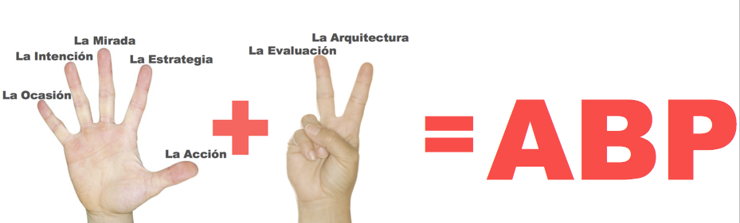

Estaba en pendiente esta segunda parte sobre ABP en la que contar **lo que SI es ABP** y sobre todo los elementos que lo componen tal como lo cuento en [**“Aprendo porque Quiero. El ABP paso a paso”**](https://www.juanjovergara.com/aprendo-porque-quiero)

Hace varias décadas que trabajo en el marco del ABP. A lo largo de los año he identificado cinco momentos diferenciados en su desarrollo y dos elementos a tener en cuenta de forma especial: **5 + 2 = ABP.**

Dedicaré este post a los dos primeros momentos del ABP: ***La Ocasión*** y ***la Intención.***

**1.- LA OCASIÓN**

Es ese momento especial en el que los docentes desarrollan la Escucha y son capaces de reconocer algo como una posibilidad educativa. Un grupo de niños están fascinados por las hormigas en el patio del recreo, un suceso importante es motivo de discusión en el centro, se aproxima el día de la mujer y los docentes piensan que puede ser una estupenda ocasión para iniciar un proyecto. O simplemente deciden desencadenar el inicio del proyecto organizando una acción provocada invitando a alguna persona especial o haciendo que algo espectacular suceda en el centro.

Tengo descritas hasta seis posibles fuentes de **“la Ocasión”** para el nacimiento de un proyecto. En todas ellas el trabajo del equipo de docentes es preguntarse:

- ¿Qué es realmente importante que mis alumnos aprendan en relación a este tema?
- ¿Cómo puede servir mi área/asignatura/materia para ayudar a la comprensión profunda de la Ocasión?
- ¿Qué elementos del currículo podré desarrollar con esta Ocasión?

Es un momento en el que los docentes deben evaluar las posibilidades que ofrece la Ocasión y revisar los contenidos de cada una de sus materias. También es un momento en el que pensar estratégicamente: ¿Qué fortalezas y debilidades tiene emprender este proyecto ahora?

**2.- LA INTENCIÓN**

Cuando los docentes deciden lanzar el proyecto lo primero que necesitan es generar la Intención en los alumnos de llevarlo a la realidad.

Crear la Intención no es motivar. No se trata de diseñar alguna actividad que llame la atención de los alumnos. Esto sería demasiado frágil para mantener un proyecto vivo a lo largo de un tiempo.

De lo que se trata es de interrogar al alumnado sobre Qué dice el tema planteado de ellos mismo: ¿qué te preocupa sobre el tema? ¿cómo lo reconoces en tu realidad inmediata? ¿Qué sientes, piensas sobre ello? ¿qué dicen tus amigos, tu familia?

Es la fase de la “Ingeniería del deseo”. Aquella en la que los docentes hacen posible que el grupo **DECIDA** emprender el proyecto.

***“No es posible modelar la arcilla hasta que está suficientemente húmeda”***

***Proverbio africano***

La Intención es un momento fundamental en el desarrollo del ABP, es necesario desplegar herramientas y recursos que permitan a los alumnos ver que nos comprometemos con una sentencia: “El aprendizaje es un acto intencional: aprendo porque quiero”.

Solo aprendemos lo que nos emociona. Es necesario abrir espacios para pueda:

- Vivirse esa Impresión.
- Expresar que se ha sentido.
- Decidir emprender el proyecto.

A partir de aquí es cuando comenzamos el diseño conjunto del proyecto: ***La Mirada***. El siguiente momento que dejo pendiente para el próximo post.

[#ABP](https://juanjovergara.wixsite.com/juanjo/blog-1/hashtags/ABP)
