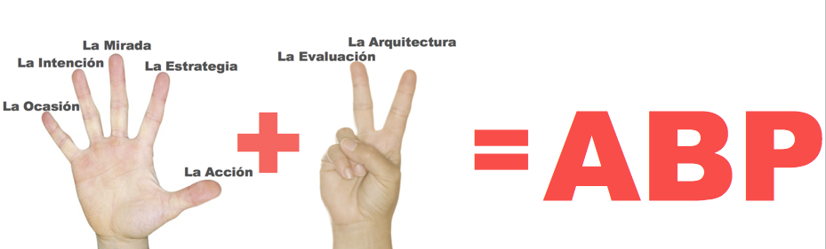

En los dos post anteriores me dedicaba a los cinco primeros momentos del ABP: **La Ocasión y La Intención** [**(en el primer post)**](http://www.juanjovergara.com/#!La-ecuaci%C3%B3n-del-ABP-5-2-ABP-I/c14gr/557f09660cf28827c187ec82) **y La Mirada, La Estrategia y la Acción** [**(en el segundo)**](http://www.juanjovergara.com/#!La-ecuaci%C3%B3n-del-ABP-5-2-ABP-II/c14gr/558795570cf288ee3f116c4b)**.** En este último, trataré los otros dos elementos que son transversales a todo el Proyecto: La Evaluación y La Arquitectura

tal como lo cuento en [**“Aprendo porque Quiero. El ABP paso a paso**](http://www.juanjovergara.com/#!aprendo-porque-quiero/c15km)**” [http://www.juanjovergara.com/#!aprendo-porque-quiero/c15km].**

**1.- LA EVALUACIÓN**

Actualmente asistimos a una verdadera confusión de términos que conviene aclarar si no queremos caer en la más absoluta de las simplezas.

Día a día encontramos quienes defienden con todas las armas que tienen a su disposición la rendición de cuentas de lo aprendido por los alumnos. Defienden la evaluación como garante del aprendizaje que ellos consideran importante en su modelo de enseñanza.

También encontramos al grupo opuesto que reclama abolir la evaluación. Dicen que la evaluación mata el aprendizaje, lo hace artificial, solo dota de poder al docente contra el verdadero aprendizaje, no mide lo que realmente es importante.

Creo que unos y otros hablan de cosas distintas y les ponen el mismo nombre. Quizá sería bueno aclarar –de una vez por todas- términos:

**Evaluar no es Calificar.**

**Calificar es un proceso de Etiquetado.** Es la acción de poner una etiqueta –numérica normalmente- al alumno en relación al grado de adquisición de determinados contenidos de aprendizaje. Este etiquetado puede hacerse con mayor o menor acierto.

Sin duda no es lo mismo etiquetar la capacidad de reproducir memorísticamente unos datos en un examen que hacerlo en función de la adquisición de determinadas competencias, comprensión profunda de contenidos o adquisición de destrezas o habilidades.

Sin embargo, en cualquiera de los casos, Calificar es Etiquetar. Esta es una labor que absolutamente todas las administraciones educativas de todos los países exigen a sus docentes, que deben asumir con mayor o menor agrado.

En último extremo responde a la idea de que el aprendiz debe rendir cuentas de su aprendizaje con vistas a promocionar en el sistema educativo; o lo que es lo mismo a ser etiquetado a su vez como alumno-ciudadano exitoso o bien fracasado, excluido, “con problemas”, etc, etc. Sobre esto no voy a extenderme cuando Ken Robinson lo cuenta muchísimo mejor que yo en cualquiera de sus charlas TED.

Evaluar es algo más que la mera rendición de cuentas. Más allá de estar a favor o en contra de ella, conviene decir que la función más relevante de **la Evaluación es la de ser un instrumento que invita a reflexionar** sobre el aprendizaje desde el principio y entre todos los que intervienen en él. Sobre esta idea [**ya he escrito con anterioridad**](http://www.blogcanaleducacion.es/examinar-luego-existo/) cuando apareció la noticia de las visibles y deseables apuestas de los jesuitas [**y en alguna ocasión anterior (como esta)**](http://www.blogcanaleducacion.es/evaluar-no-es-calificar/) . [**O también aquí.**](http://www.blogcanaleducacion.es/spoiler-y-evauadores/)

Como resumen, en el ABP la evaluación es un proceso colaborativo en el que es preferible hablar de co-evaluación ya que todos los que intervienen en el proyecto deben reflexionar, conjunta e individualmente, sobre qué está pasando, cómo se incorpora a mi forma de ver el mundo –comprenderlo- y qué decido hacer con aquello que aprendo.

En definitiva entender la evaluación en tres dimensiones que la diferencian de la simple acción de calificar:

- **Rendir Cuentas:** Reconocer qué hemos aprendido, qué he sentido, cómo lo he hecho, con quién, qué habilidades he puesto en juego, que competencias he desarrollado, qué acciones he emprendido.

- **Dar Sentido:** Interrogarse sobre uno mismo. Cómo me ha cambiado la forma de percibir el mundo, la realidad; cómo me ha cambiado como persona, qué utilidad concreta tiene lo que he aprendido y cómo puedo ponerlo en práctica.

- **Marcar la Dirección:** Después de este aprendizaje; qué decido hacer con ello, qué acciones decido emprender, qué nuevos aprendizajes me interesan.

Las herramientas para la evaluación son muchas: rubricas, portafolios, evaluación creativa, situada, etc. sobre todo ello trato en el libro.

**2.- LA ARQUITECTURA**

Un proyecto tiene que poder ser contado como una historia. Como la bonita historia de un grupo que se sorprende ante una Ocasión y decide emprender una aventura: el aprendizaje.

Esta forma de entender el aprendizaje nada tiene que ver con la anquilosada visión de asignaturas inconexas entre si que a su vez están diseccionadas en unidades temáticas, apartados, preguntas, problemas, etc.

Un proyecto tiene que poder ser narrado. Una narración en la que existe un inicio a partir del cual comienzan a pasar cosas, se crean preguntas, información, relaciones, emociones, itinerarios de indagación, de creación. Se suman personas de dentro y fuera de la escuela acompañando un proceso que al final termina con alguna acción comprometida con el aprendizaje y el grupo que lo lidera.

En esta historia caben los errores –eso que suele ser excluido del día a día escolar y es la fuente más importante de aprendizaje de todos nosotros-. También caben todo lo que aportan los alumnos, los docentes y el resto de actores que han participado proyecto –entidades sociales, familias, expertos, etc.-.

Para que todo esto suceda es necesario que exista una Arquitectura que permita hacer visible el proyecto. Un espacio en el que cada miembro del proyecto –y también quienes no han participado en él- puedan consultar los materiales, recorrer el día a día, compartir con quienes lo protagonizan cada momento del mismo.

Para edificar La Arquitectura del proyecto muchos usan recursos online –blogs, web, redes, infografías, paneles digitales, presentaciones dinámicas, realidad aumentada, etc.-.

Otros llenan las paredes de sus centros de carteles, dibujos, sonidos, proyecciones, etc.

Algunos –fantásticos y fanáticos de la educación- hacen las dos cosas. Convierten el centro y su proyecto en algo emocionante.

***Sólo aprendemos lo que queremos. Tan sencillo como esto. La enseñanza es el arte de crear la Intención de iniciar un proyecto, acompañarlo y apoyarlo con todas las herramientas de que disponemos para ello.***
