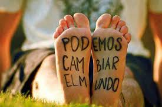
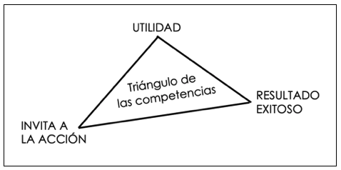
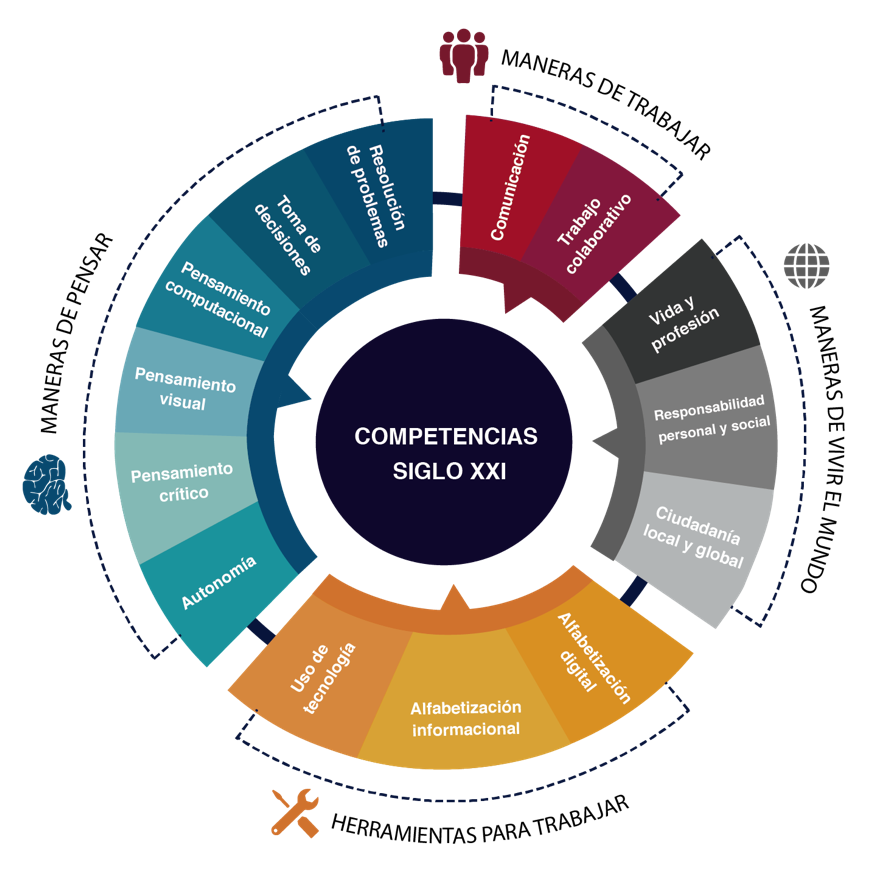

***Todo hacer es conocer y todo conocer es hacer.***

***Humberto Maturana***

[**[Publicado en España en Diario de la Educación]**](http://eldiariodelaeducacion.com/blog/2019/09/24/educar-para-cambiara-el-mundo-que-son-para-que-sirvenn-y-para-que-deben-servir-las-softskills/)
[**[Publicado en México en Otras Voces en Educación]**](http://otrasvoceseneducacion.org/archivos/322942)

Hace años llevo hablando de soft-skills en cuantos foros intervengo. De ello son testigo decenas de docentes con los que he desarrollado talleres sobre el Enfoque de Proyectos o reflexionado en conferencias de todo tipo sobre qué acentos debemos poner en la Innovación en los centros. Es una gran noticia que empiecen a ponerse en la superficie del discurso educativo y que orienten la práctica de decenas de docentes insatisfechos con la enseñanza. Docentes que deben diseñar sus clases sabiendo que estas no se adaptan a las necesidades de los alumnos que deben educar.

**Qué son las soft-skills**

Cuando imaginamos qué necesitarán nuestros alumnos en el momento crucial de su primera entrevista laboral, es habitual que pensemos en decenas de conocimientos técnicos y científicos que les hemos trasmitido. Ellos -sin embargo- tienen claro que no será eso lo que les proporcionará su ansiado puesto de trabajo.

Imagina un ingeniero informático que es convocado a una entrevista de trabajo. Seguro que piensas que la noche anterior a la cita repasa conceptos de vanguardia sobre programación, últimas tendencias en arquitectura computacional, etc. Sin embargo lo que se encuentra al llegar a la cita laboral es radicalmente distinto.

Es especialmente didáctico el texto de John W. Moravec al respecto:

*Con el término knowmad32, Moravec (2008b) hace referencia a aquellos trabajadores nómadas del conocimiento y la innovación. Un knowmad es alguien innovador, imaginativo, creativo, capaz de trabajar con prácticamente cualquier persona, en cualquier lugar y en cualquier momento. Un knowmad es valorado por su conocimiento personal, lo que le proporciona una ventaja competitiva con respecto a otros trabajadores. La sociedad industrial está dando lugar a trabajos intensivos en el conocimiento y la innovación. A diferencia de la sociedad 1.0, cuya industrialización requería trabajadores ubicados en un lugar determinado para poder desempeñar un trabajo o unas funciones muy concretas, los empleos asociados a los trabajadores del conocimiento y la información se han vuelto mucho menos específicos en términos de ubicación y de las tareas a desempeñar. Además, las tecnologías hacen posible que los trabajadores de este nuevo paradigma puedan efectuar su trabajo ya sea en una ubicación específica, de manera virtual o combinando ambas opciones. Los knowmads tienen la capacidad de volver a configurar y contextualizar su espacio de trabajo en cualquier momento; esta creciente movilidad está generando nuevas oportunidades. Pongamos como ejemplo una cafetería, ya que se trata de un espacio de trabajo escogido por muchos knowmads. ¿Qué ocurre cuando alguien que se dedica a la banca de inversiones se sienta junto a un arquitecto y entabla una conversación? ¿Qué ideas, productos y servicios pueden surgir a raíz de esta charla? Esta remezcla de espacios y de relaciones sociales está afectando también a la educación. Los estudiantes de la sociedad 3.0 tendrían que poder aprender, trabajar, jugar y compartir en prácticamente en cualquier contexto. Sin embargo, son pocos los indicios existentes que nos permitan afirmar que la educación está evolucionado hacia el paradigma 3.0.*
*(Cobo, C. y Moravec, J. (2011): Aprendizaje invisible. Hacia una nueva ecología de la educación. Col-ecció Trasmedia XXI. Universidad de. Barcelona. p 56. )*

Cuando este ingeniero informático acude a su entrevista de trabajo sabe que no destacará del resto de aspirantes gracias -y de forma exclusiva- a los conocimientos técnicos que posea sobre informática. Serán otras las habilidades determinantes para su selección positiva. Sin embargo el modelo educativo que mayoritariamente domina en el mundo sigue haciendo pensar a los docentes que son los conocimiento técnicos aquellos que asegurarán el éxito de sus alumnos.

*Un aprendizaje que busca ser significativo para quienes participen en la experiencia educativa. En él se fomenta por encima de todo la aplicación práctica del conocimiento a nuevas formas de resolución de los problemas, más que la repetición mecánica de datos previamente aprendidos.*
*(supra. p.61)*

**Pero, ¿qué esperan entonces de mis alumnos?**

El día que Julián -tu antiguo alumno ahora flamante técnico informático- acuda a una entrevista de trabajo, será importante que demuestre tener los conocimientos técnicos adecuados a su titulación académica. Sin embargo, la empresa que lo contratará sabe que estos cambiarán radicalmente en pocos años. La idea de un conocimiento inalterable a lo largo de las décadas es cosa del pasado y quienes evaluarán a tu antiguo alumno saben que es así.

Por encima de estas habilidades técnicas saben que es necesario incorporar a una persona con algunas cualidades especiales:

- **Inteligencia emocional.** Cuando una empresa decida contratar a Julián buscará en el que sepa integrarse emocionalmente al proyecto. La metáfora de la empresa como familia es sin duda uno de los elementos más demandados en los procesos de selección. Quieren que Julián se incorpore a su nuevo puesto de trabajo sintiendo como suyo el proyecto que desarrolla.
- **Inteligencia social.** Es especialmente bien valorada la capacidad de relación y trabajo en equipo. Para ello no solo hace falta una cierta dosis de habilidades sociales. Es necesario también capacidad de liderazgo, resolución de conflictos, capacidad de establecer y/o integrarse en una red de relaciones formales y no formales, capacidad de movilidad, de cambio.
- .**Creatividad.** La empresa que contraten a Julián valorarán especialmente hacerlo de una persona que es capaz de aportar un valor añadido a su proyecto laboral. Alguien que sabe hacer propuestas, que idea caminos alternativos a los habituales y es capaz de emocionarse con ellos y contagiarlo.
- **Inteligencia ejecutiva**. O lo que es lo mismo; ser capaz de llevar a la realidad sus propuestas. Analizarlas y ver la viabilidad de las mismas.

El ejemplo que describo es útil para las habilidades que necesitan desplegar nuestros jóvenes al enfrentarse al mundo laboral. Lo más interesante del asunto es que **son las mismas que necesitamos para construir activos ciudadanos de un mundo complejo en el que la participación social o el habitar las relaciones personales, afectivas o comunitarias exigen nuevas estrategias que invitan a la reflexión y el empoderamiento.**

**Habitar el mundo actualmente, tiene poco que ver con ejercer modelos reproductivos de comportamiento. Las relaciones sociales y afectivas en la actualidad han cambiado radicalmente y exigen gran capacidad de respuesta ante las nuevas demandas de un entorno en constante cambio. Igual sucede con la participación ciudadana, el mundo del trabajo, las relaciones sociales o familiares.**

**Así pues, cuando hablamos de habilidades a desarrollar en nuestros alumnos, no solo estamos pensando en aquellas que les permitirán el acceso a un puesto de trabajo exitoso en el futuro. También lo hacemos pensando en aquellas que les empoderan en su vida personal, relacional y ciudadana. En definitiva se trata de dibujar aquellas habilidades que permitirán a nuestros alumnos una vida activa y de éxito en todas las esferas de su habitar el mundo, frente a aquellas que les relegan a un lugar alienado -pero imaginariamente confortable- de una sociedad que ya no existe.**

**¿Hard-skills o Soft-skills una dicotomía o un potente equipo educativo?**

Una de las cosas que más me seduce de las soft-skills es la discusión que provoca sobre la importancia de educar en las llamadas “habilidades duras” (hard-skills), o bien, las “habilidades blandas” (o soft-skills). Las primeras parecen hacer referencia a las relativas a conocimientos técnicos y las segundas a aquellas buscan desarrollar habilidades de gestión del conocimiento, redes, habilidades sociales y otras que más adelante detallaré agrupándolas en categorías educativas.

En decenas de cursos y conferencias he tenido ocasión de escuchar a docentes escépticos con el cambio en educación acusando a los renovadores de relegar al ninguneo más absoluto habilidades que consideran importantes. “¡Es necesario educar la memoria!” “¡No solo es importante desarrollar competencias, es necesario que los alumnos aprendan ‘cosas’ relacionadas con las materias que impartimos!”. Tienen razón.

La memoria es importante. También la capacidad de resolver un problema. Es necesario entrenar determinados procedimientos que se alojarán en nuestro cerebro para toda la vida: ¡Efectivamente, debemos saber de memoria la tabla de multiplicar!. Sin embargo no es lo único que nuestros alumnos deben aprender.

Cuando Bloom formuló su famosa taxonomía se popularizó la idea de que existían determinados procesos de pensamiento de orden inferior que no podían competir con los llamados de orden superior. Esto es un gran error: todos son necesarios para el aprendizaje.

Efectivamente la memoria es necesaria para el aprendizaje. No es esta la discusión. Lo relevante es entender que no podemos diseñar la enseñanza atendiendo el noventa por ciento del tiempo a estos procesos de pensamiento -de orden inferior- sabiendo que las exigencias de la sociedad que habitamos necesita de nuestros aprendices el desarrollo de procesos como la creatividad, la resolución de problemas o el pensamiento crítico -o lo que es lo mismo la capacidad racional de evaluar-. Los procesos de pensamiento de orden superior no pueden quedar relegados al diez por ciento del tiempo escolar en términos de diseño didáctico. Máxime cuando son los procesos de pensamiento que parecen más adecuados para construir las habilidades que nuestros alumnos necesitarán en su habitar el mundo que les ha tocado vivir.

**Un poco de historia educativa.**

Hace poco más de un siglo -bastante poco en términos históricos- la educación tenía dos características:

- Cumplía la función de transmisión cultural y mantenimiento del estatus quo de una sociedad estable en cuanto a sus personas, valores y cosas.

- Se refería a una etapa determinada de la vida: la infancia y adolescencia -en la mayor parte de las ocasiones- o como mucho a la primera juventud en el caso de aquellos privilegiados -normalmente hombres- que podían optar a estudios superiores.

La historia de la innovación educativa normalmente tiene un punto de inflexión al que todos se aferran: la llamada escuela nueva. Un grupo excepcionalmente heterogéneo de pensadores de la educación. Su aportación es innegable. Estamos en los años finales del siglo XIX -o principios del XX- y es necesario dirigir la mirada hacia la identidad del aprendiz. Hoy -más de un siglo después- el mundo ha cambiado mucho y las necesidades educativas que dibujaron siguen intactas en algunos casos y otras son profundamente distintas.

Desde mi punto de vista, hay referentes más interesantes que invitan a entender el cambio educativo necesario en nuestras aulas hoy en día. Freire -humanista- decía que la educación no cambiará el mundo. Lo harán las personas y apostaba por una educación centrada en la toma de conciencia crítica. Otros han apostado por la capacidad de la educación para el cambio social y la han situado como motor de cambio de las sociedades hacia la justicia social. Algo que en la sociedad del calentamiento global parece urgente en cada 15 de agosto en cualquier país del Mediterráneo.

Con un poco de perspectiva histórica, es necesario recordar que no hace tanto tiempo la educación era cosa que terminaba en torno a los 15-20 años de edad. Más allá de esto solo existía la educación “de la segunda oportunidad” protagonizada por la educación de adultos o la de élite, protagonizada por los estudios superiores que solo algunos eran capaces de costear.

Fue Coombs a finales de la década de los sesenta del siglo pasado quien dijo algo que era necesario oír: el aprendizaje es una experiencia que se desarrolla a lo largo de toda la vida (Coombs: La crisis de la educación, 1968). A partir de Coombs empezamos a hablar de la Educación Permanente como el Sistema de los sistemas educativos -en esa visión sistémica de la sociedad tan de la época-. Fue una gran noticia para la educación saber que esta no era una tarea acotada a un periodo y una esfera de la vida. La educación comienza a ser algo permanente y que recorre toda la vida de cada persona: **¡La educación formal, no formal e informal se dibujan en el universo del aprendizaje y están presente a lo largo de toda la vida de las personas!.**

La otra gran noticia llega con el famoso informe Delors (1996: La educación encierra un tesoro) en el que los pilares de la educación dejan de ser la transmisión de conocimientos y se enriquecen con los cuatro grupos de competencias que hoy nadie se atreve a negar: conocer, ser, vivir juntos y hacer. El informe Delors ha pasado a la historia como uno de los grandes textos que han buscado revolucionar el concepto de educación adaptándola a las necesidades de una sociedad que ya a finales del siglo pasado se sabía cambiante.

Efectivamente aprender es algo de toda la vida -educación permanente-, todas las esferas de nuestro habitar el mundo -educación formal, no formal e informal- y responde a las necesidades que nos impone una sociedad cambiante. Pero también es un acto político: la educación es un arma. Parafraseando aquel entrañable libro de Lacoste (1976) -la geografía: un arma para la guerra- podemos decir que La Educación es -posiblemente- el último acto comprometido con un planeta herido.

**La educación es un acto profundamente político.** Situarnos junto a una comunidad de aprendizaje nos obliga a pensar qué queremos hacer con lo que enseñamos y cómo esto va a servir para construir un mundo mas habitable, más justo y en el que nuestros aprendices sean más felices en términos individual y globales.

Estamos en un escenario comprometido. **La educación, o sirve para perpetuar una sociedad desigual y avocada al colapso medioambiental, o sirve para empoderar a los aprendices en su habitar un mundo herido**. En definitiva, la educación puede ser una herramienta práctica para el cambio de tendencia en una sociedad que hoy sabemos amenazada con el colapso.

En términos de práctica educativa todo esto nos lleva a una reflexión interesante: Nuestro trabajo es un acto de compromiso con el mundo que soñamos… ¿Qué mundo sueñas como docente?

**Habilidades y competencias**

DESECO define las competencias como una habilidad que puede demostrarse en la práctica.

*Una competencia es la capacidad para responder a las exigencias individuales o sociales o para realizar una actividad o una tarea. (OCDE, proyecto DeSeCo, 202, p. 8).*

Se han escrito ríos de tinta sobre la necesidad de cambiar el paradigma de la educación hacia una formación competencial. No voy a navegar en ellos en este momento. Pero si quiero señalar tres aspectos que me gustan especialmente de esta manera de entender la educación y que están obligando -desde hace poco más de un siglo- a redefinir aspectos del currículo antes intocables: el espacio, el tiempo, el papel del docente, la comunidad, etc.

**1. Utilidad**

El desarrollo de una competencia viene asociado a una necesidad concreta del aprendiz. La competencia se desarrolla en la medida que sirve para algo. Aprendemos porque queremos y con una finalidad determinada. El aprendizaje debe surgir de una necesidad vital del individuo. Si no es así, el aprendizaje se diluye tan rápido como se construye. Además, carece de sentido.

**Cualquier aprendizaje que no permite hacer algo con él es un lastre en la mochila del saber del individuo.**

**2. Resultado exitoso.**

Una habilidad permite el ejercicio de una actividad, pero ser competente en su desarrollo requiere que este se pueda evaluar como especialmente exitoso.

Nadie dirá de un director de un colegio que es un competente director si no se puede acreditar su éxito en la labor que realiza. Lo mismo ocurre con el resto de los ámbitos de la vida personal, comunitario o profesional.

**Las competencias permiten -con éxito- el desarrollo práctico de necesidades vitales.**

**3. Exige la acción.**

En la medida que se evalúa referida a su capacidad de responder con éxito a una exigencia personal, social o profesional; exige que el aprendiz se comprometa con su entorno. Es necesario actuar sobre la realidad para ponerla en juego. Esto obliga a desarrollar el pensamiento crítico.

**Ser competente en el desarrollo de una tarea exige comprometerse vitalmente dando una respuesta personal a una exigencia individual o social. Exige una acción comprometida.**

Desde hace algunas décadas existe bastante consenso sobre cuáles son las competencias que deben protagonizar el aprendizaje del ciudadano del siglo XXI:

Fuente: http://www.eafit.edu.co/proyecto50/novedades/PublishingImages/Paginas/Habilidades+necesarias+para+ser+competente-/GraficoCompetencias-032.png [consultado el 10/09/19]

Parecen un referente interesante para pensar la educación actual. El reto es cómo incluirlas de forma normalizada en nuestras clases teniendo en cuenta que las necesidades que los docentes observamos en la enseñanza debe convivir con un modelo educativo que cambia bastante más despacio de lo que nos gustaría y que las exigencias a que los docentes se ven sometidos día a día encorsetan sus deseos de innovación: pruebas externas, rankings educativos, presión de las familias, modelos burocratizados en la gestión de los centros, administraciones educativas basadas en el control, etc.

Me gusta especialmente hablar de competencias cuando sueño la educación como el arma para mi guerra. O mejor como la que puede dibujar un escenario distinto al que habitamos.

En otro momento (Vergara, 2015) defendía que educar en las competencias no solo exige desarrollar determinadas habilidades. Es necesario poder ejercerlas. Nadie podrá decir de un carpintero que es competente hasta que no le permitan ejercer su oficio y demostrar lo destacado de su arte. Nadie podrá decir que un director de marketing es competente hasta que no le permitan ejercer este cargo. **Ser competente -como señalaba acertadamente DeSeCo- solo puede demostrase en la práctica.**

Educar las competencias no es solo tarea del docente. Es algo que implica al centro y cómo piensa su labor en el contexto que habita. Una tarea a la que se dedica como organización.

**Educar en competencias es dibujar un centro que interviene en su entorno, define su modelo relacional, su espacio de participación, los roles de quienes lo habitan y el sueño que les orienta a la acción.**

**¿Cómo trabajar con ellas en educación?**

La importancia de cambiar el paradigma hacia un aprendizaje competencial es innegable. Sin embargo, su implantación en los distintos niveles de enseñanza no se ha visto acompañado de su relevancia para formar a nuestros alumnos en activos ciudadanos de un mundo que necesita de su capacidad de responder con éxito a unas demandas apremiantes: cambio climático, pobreza, desigualdad, aislamiento social, etc.

El trabajo que mayoritariamente se ha realizado para incluir el tratamiento de las competencias en educación, ha sido el de dotar a los alumnos de capacidades para responder a situaciones prácticas y cambiantes. Pero tristemente no se ha entendido -en la mayoría de los casos- que para que esto suceda es necesario que la propia organización educativa sea capaz de cambiar en su conjunto convirtiéndose en un entorno educador. Un entorno en el que el desarrollo de las competencias de sus alumnos forma parte de su propia estructura organizativa, el modelo relacional, toma de decisiones, relaciones con la comunidad donde se inserta, etc.

De alguna manera se ha enviado un discurso profundamente contradictorio a alumnos, docentes y familias:

1. Es necesario desarrollar competencias en los alumnos ya que deberán responder de forma práctica, creativa y ajustada a situaciones desconocidas y en un .

2. El aprendizaje de estas competencias se va a realizar en unas profundamente estables, en el que los procedimientos de cambio son insoportablemente lentos y burocratizados.

La respuesta a esta contradicción ha tenido reflejo en cómo se han tratado en los currícula la evaluación. También sus consecuencias a la hora de convertirse en un elemento de segregación y no de inclusión de alumnos, centros, entornos geográficos e incluso países.

**Frente a una visión estrecha de las competencias que miran de forma exclusiva a los alumnos y los docentes, es necesario entender que pensar una educación para el desarrollo de competencias es un cambio importante de mentalidad que implica directamente al centro en su conjunto, su modelo organizativo, relacional y el papel que este juega en el entorno que habita.**

Un centro que se compromete con el desarrollo de competencias es un centro que toma partido. Un centro que piensa sobre el papel que -él y sus alumnos- pueden jugar en el mundo que sueñan. Que les empodera para actuar y convertirse en ciudadanos activos. Para responder de forma competente a las preguntas que se realiza en torno a lo que le rodea. Hacerlo exige desarrollar determinadas habilidades.

**Son estas habilidades las que podemos trabajar dentro del aula. Las que se convertirán en las piezas del puzle que el alumno decide montar como respuesta a su toma de postura crítica en relación con las demandas que recibe del entorno.**

Así pues, los docentes tenemos dos tareas a las que podemos abandonarnos si apostamos por el aprendizaje competencial:

1.- Trabajar con los alumnos el desarrollo de habilidades apropiadas para dar respuesta a su mirada crítica del entorno que le rodea. Dentro de ellas, parece que las más adecuadas al contexto que habitarán los alumnos en su vida, son las llamadas habilidades blandas -o softskills- ya que le dotan de herramientas de gestión en un mundo complejo y líquido.

2.- Demandar -y trabajar a favor de- un centro que sitúa a su comunidad como un agente de cambio Una comunidad que reflexiona sobre las demandas de su entorno. Que toma partido por su papel como protagonista en su comunidad y el futuro social. Y también que adapta sus estructuras organizativas, modelos relacionales, sentido de su historia y su proyecto de futuro para convertirse en un entorno que permite ejercer las competencias que decide desarrollar en sus alumnos.

**¿Cómo integrar las softskills en tus clases?**

Cuando programas una clase lo primero que haces es revisar el currículo relativo a tu materia o ámbito educativo. La referencia a la legislación es obligada ya que sabes será determinante para tu evaluación positiva como docente.

Una vez decidido el contenido de tus enseñanzas -aquello que quieres trabajar- quizá sea buena idea realizarnos algunas preguntas:

1. Lo que quiero enseñar a mis alumnos ¿dónde lo pueden ver en su realidad concreta, en su contexto cercano?
2. Aprender esto, ¿Cómo les ayuda a mejorar la comprensión de su realidad cercana?
3. ¿Qué podrán hacer con ello? ¿Para qué les sirve en términos concretos?
4. ¿Cómo voy a provocar que utilicen este nuevo conocimiento para intervenir sobre su entorno cercano?
5. ¿Qué instrumentos diseño para que mis alumnos puedan comprobar que este nuevo aprendizaje ha sido útil y valioso para su habitar el mundo?

La rutina -así descrita- se aleja bastante a entender el aprendizaje como el acto alineado de memorizar y reproducir contenidos ajenos a las necesidades del aprendiz. Esto no quiere decir que el alumno no deba memorizar, entrenar o rendir cuentas de lo aprendido. Lo que significa es que estos procesos deben estar al servicio de contextualizar el aprendizaje y ponerlos en relación con su contexto: análisis crítico y acción.

*Imagina que como docente deseas trabajar el concepto de energía. Sabes los contenidos que debes tratar ya que has consultado el currículo y tienes como referencia algún libro de texto que te facilita explicar este concepto y asegurarte que los alumnos lo memorizan y comprenden ya que cuentas con una gran batería de ejercicios y pruebas de evaluación que te permitirán comprobarlo. Al terminar puedes asegurar que tus alumnos han comprendido el concepto de energía y han memorizado aquellos conceptos clave que se exigen en el curso. ¿Cuánto tiempo crees que tardarán tus alumnos en olvidar aquello a lo que tanto trabajo has dedicado?*

*Imagina que decides hacer otra cosa; les planteas un reto: “que busquen mejorar el gasto energético en su casa ideando una propuesta que hacer a su familia”. Pueden ayudarse en grupos e incluso pedir colaboración a quien consideren oportuno. Para ello deberán comprender el concepto de energía y les ofreces materiales apropiados para ello, les conectas con algunas páginas en internet que hablan de la energía en relación a su edad y también al centro del problema que deben resolver. Como complemento ideas algunas actividades para trabajar en grupos sobre aspectos concretos del tema y también generas algunas dinámicas grupales para facilitarles que se ayuden mutuamente -sin duda los recursos del trabajo cooperativo son ahora muy interesantes-. Al llegar a casa tus alumnos deberán comentar el reto con sus familias y pedirles ayuda. Deberán revisar las facturas energéticas y explorar los consumos de su hogar. Una vez hecho todo esto deberán formular su solución al reto y deberán ser capaces de exponerla en clase y defenderla correctamente.*

Sin duda el reto al que nos enfrentamos es conseguir que los contenidos que queremos trabajar sirvan como herramientas para desarrollar habilidades para la vida de nuestros alumnos.

**Categorías en las softskills y objetivos educativos**

Cuando leemos sobre softskills comprendemos que son importantes para formar a los ciudadanos críticos y comprometidos que queremos para nuestros alumnos. Las habilidades relacionales, desarrollo de pensamiento crítico, creatividad, etc. sabemos fundamentales para el mundo que les toca vivir. Sin embargo es difícil integrarlas en nuestras clases. El día a día está dominado por una carrera de obstáculos en la que urge cubrir el temario correspondiente, las evaluaciones y las demandas externas (dirección, inspección, legislación, etc.)

Una propuesta realista para empezar a incorporarlas en tu trabajo en el aula puede ser describir algunas categorías de habilidades y dentro de cada una de ellas formular objetivos educativos concretos que puedan acompañar tus proyectos educativos día a día. En **“Narrar el aprendizaje”** lo explicaba así:

**Aprender no es acumular; es una aventura: El aprendizaje como proceso.**

Ser capaz de aprender a lo largo de toda la vida implica tener las habilidades necesarias para emprender cualquier aprendizaje de forma autónoma. Saber dónde y cómo puede encontrar la información, quién puede ayudarle. Estructurar su tarea y hacerla efectiva.

Esta visión del aprendizaje no es compatible con un modelo basado en la transmisión de conocimientos en el que las únicas habilidades que se piden al aprendiz es la memorización y la réplica de los modelos de pensamiento de quién transmite el conocimiento.

Entender el aprendizaje como un proceso supone dotarles de las habilidades necesarias para que el alumno entienda el aprendizaje como un proyecto personal en el que él es el protagonista. Participa activamente en cada fase del proyecto planteado desarrollando las tareas propias y en ellas identifica los contenidos curriculares relacionados.

**Aprendemos mejor juntos que en solitario: Habilidades cooperativas.**

Estas tienen que ver con desarrollar habilidades de aprendizaje cooperativo adaptando las herramientas y capacidades de trabajo en grupo a la tarea planteada. La habilidad de cooperar como recurso valioso en el logro de una meta conjunta y en definitiva aquellas que facilitan los procesos de aprendizaje grupal: resolución de conflictos, empatía, habilidades comunicativas, escucha, etc.

**Podemos hacerlo y sabemos cómo: Capacidades ejecutivas.**

Las habilidades ejecutivas tienen que ver con la capacidad de llevar a la práctica una idea o proyecto.

Se refiere al desarrollo de habilidades de liderazgo colaborativo y aquellas que se orientan a facilitar la gestión y toma de decisiones conjunta orientado al logro. La capacidad de ofrecer soluciones de gestión grupal, reparto de trabajo, visión estratégica, etc. que se demuestran como un valor en la eficacia del trabajo de conjunto.

También la capacidad de analizar la viabilidad de un proyecto e identificar las debilidades y fortalezas que tiene de cara a su puesta en práctica: ¿cuánto tiempo necesitamos? ¿quién puede ayudarnos? ¿cómo podemos organizarnos para ser más eficaces?, etc.

**Veo, pienso y decido: Pensamiento crítico.**

El pensamiento crítico supone desarrollar la capacidad de análisis y juicio crítico. Ser capaz de anticipar la reflexión al juicio y que esta, progresivamente, se hace más sistemática identificando puntos fuertes y débiles de cada opción. Así mismo la capacidad de ofrecer su reflexión al resto de compañeros estando abierto a incorporar sus análisis, opiniones y juicios.

**El camino más corto no siempre es el mejor: Pensamiento creativo.**

Se trata de desarrollar habilidades de flexibilización de pensamiento. No conformarse con una única solución a un problema planteado y buscar activamente alternativas que la mejore (pensamiento lateral). También la capacidad de aplicar modelos similares a situaciones muy distintas de forma que se ofrezca soluciones creativas a problemas planteados (pensamiento transferente).

**Habilidades… ¿para qué?**

Educar es un acto político. El que lo niega ignora que haciéndolo está ejerciendo una posición determinada en el escenario comunitario: la alienación y la transmisión acrítica de determinados valores sociales -sean estos cuales sean-.

Nadie en su sano juicio niega el sueño de una sociedad justa, equitativa, en el que la pobreza o el hambre no existen. Nadie defendería una imagen de un planeta contaminado en el que la vida es imposible. Tampoco que el lugar de nacimiento es un factor de justicia para justificar la guerra, la muerte, la discriminación o el analfabetismo.

Sin embargo no podemos ser optimistas. El planeta está herido. Decenas de pensadores alertan del colapso en el que habitamos. Un colapso en todos los ámbitos de nuestra vida: personal, medioambiental, social y participativo.

**La educación es el único** ***arma para esta guerra.*** **La función de la educación debe -más que nunca- convertirse en el agente que empodere a nuestros alumnos y les sitúe en la capacidad de revertir el colapso. Para esto no es suficiente con algunas correcciones estructurales; es necesario un cambio radical en las mentalidades.**

**Difícilmente nuestros alumnos van a reflexionar activamente sobre su realidad si no les dotamos de las armas que lo permiten. Educar en habilidades es urgente. Reflexionar, compartir, soñar, idear, analizar, llevar a la práctica, buscar caminos creativos deben ser los verbos que protagonicen la educación si es que queremos que nuestros alumnos habiten un mundo que hoy está profundamente herido.**

.
