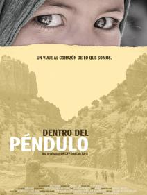

Hace poco menos de un mes acudía a Cineteca (Madrid) para disfrutar del estreno de un documental que han dirigido Bruno Costa y Andrés Marquez y que narra un proyecto que recorre mas de diez años de mis profesión: "El péndulo de Ifoulou".

Al Atlas viajamos educadores y educadoras en formación junto a cineastas que grababan todo lo que sucedía. Fue un momento emocionante que me encantó compartir y que debo recordar.

En estas fechas se publica una extensa entrevista a los autores de este documental y en la que acompaño narrando el sentido del proyecto. Para mí, es interesante es la capacidad de viajar para construir miradas que nos edifican como docentes del futuro.

El viaje comenzó con la busqueda de cambiar la mirada allá por el 2010. La aventura de este documental lo hizo cuando Juan Carlos y yo tomamos un café y decidimos que ibamos a apostar por desarrollar un proyecto conjunto. Un testigo que Luis y Marcos decidieron recoger y que debemos agradecer todos y todas.

Os enlazo el reportaje. Espero que las viajeras y viajeros que esta última década ha mirado desde los ojos del proyecto pueda decir -como lo hacían algunos al terminar- que han construido profesionales comprometidos.

[https://www.elplural.com/el-telescopio/innovacion/cambiar-mirada-formacion-profesional-base-innovacion\_234853102](http://www.elplural.com/el-telescopio/innovacion/cambiar-mirada-formacion-profesional-base-innovacion_234853102)
