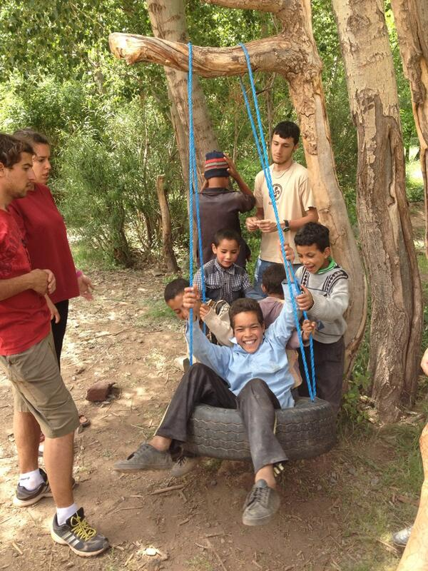

[[Publicado en eduforics.com]](http://www.eduforics.com/es/el-aprendizaje-basado-en-proyectos-abp-es-una-herramienta-para-el-cambio-escolar/)

La innovación educativa solo tiene sentido si consigue cambiar la vida de los centros y hacer que nuestros alumnos y alumnas sean más competentes. Más activos y comprometidos como ciudadanos, profesionales y personas.

Desde hace años recorro decenas de escuelas que han implementado el ABP. Proyectos que tienen eco en las redes sociales, los premios educativos o los congresos sobre innovación. Sin embargo, solo algunos de ellas consiguen que la vida en sus pasillos cambie paso a paso en cada proyecto que protagonizan. Estos son los centros que me interesan.

Algunas preguntas que suelo escuchar en muchos foros en que participo sobre ABP son: ¿Pero el ABP para qué? ¿en qué mejora el aprendizaje? ¿Cuáles son los beneficios en relación con otros enfoques didácticos? Son preguntas importantes y deben centrar la elección de este -o cualquier otro- marco pedagógico.

El ABP no es la mejor estrategia para todos los objetivos educativos que soñamos los docentes. Tampoco la única. Los escasos estudios científicos sobre los beneficios del ABP señalan que este enfoque metodológico puntúa bastante mejor a la hora de desarrollar -en los alumnos- los procesos de pensamiento de orden superior. Esto quiere decir que el ABP es una buena herramienta para desarrollar el pensamiento crítico, creativo e incluso el ejecutivo. Sin embargo, solo puntúa algo mejor en el desarrollo de procesos memorísticos, reproductivos, etc.

Una idea clave -que se deduce de estos estudios- es que debemos ser prudentes en el manejo **de las herramientas didácticas. Lo inteligente será disponer de una amplia batería de recursos ....** [**[SEGUIR LEYENDO]**](http://www.eduforics.com/es/el-aprendizaje-basado-en-proyectos-abp-es-una-herramienta-para-el-cambio-escolar/)
