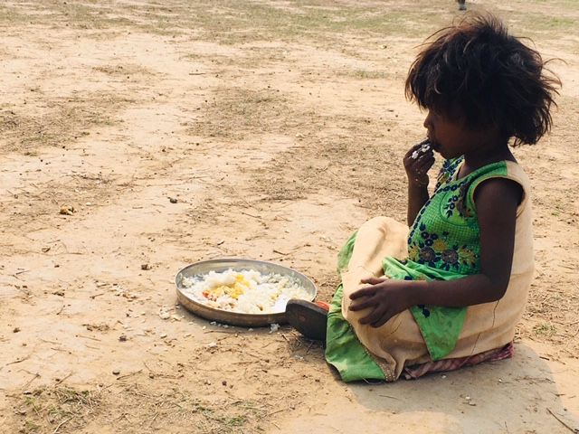

[[Publicado en la Revista Internacional de Educación para la Justicia Social]](https://revistas.uam.es/riejs/article/view/12085/12007)

Hace poco menos de dos meses regresaba de India con un grupo de docentes en formación. Vivíamos un proyecto que nos ilusiona –las estancias formativas de labine.org– que nos llevó a compartir con el proyecto de Desing for Change en India y también intervenir directamente en las escuelas de Jhajjar del proyecto de Pasahaur Don Bosco Educa con decenas de niños y niñas en que el trabajo es lo que menos maltrata la infancia. En unas Bhattas (empresas ladrilleras) que encadenan familias de empobrecidos y empobrecidas de sol a sol por unos míseros euros.

Mientras las educadoras y educadores en formación vivían emocionadas en su piel la relación con esta realidad, nosotros leíamos –día a día– las noticias sobre la evolución del coranovirus en España. Debíamos volver y estábamos realmente alarmados.

.... [[SEGUIR LEYENDO]](https://revistas.uam.es/riejs/article/view/12085/12007)
