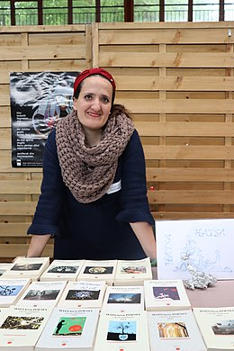

Por: Ainara Maya Urroz

El día 8 de abril realizaba un webinar para el proyecto Mentor (INTEF-Ministerio Educación-España). Algunos días después tuve la fortuna de recibir el mensaje de Ainara Maya que había realizado un resumen en euskera del mismo y me enviaba generosamente.

Ainara Maya es técnica en didáctica y diseño del currículum para la enseñanza del euskera a adultos.Además es poeta y escritora en su tiempo libre:

<http://otherwordsliterature.eu/eng/writer/48/ainara-maia%20urroz>

<https://eu.wikipedia.org/wiki/Ainara_Maia>

ABP (Aprendizaje Basado en Proyectos:

Asteazkenean, hilak 8, arratsaldeko 17:00etan, webinarra bideratu du Juan Jose Vergarak, langai "Proiektuetan oinarritutako Ikaskuntza (POI, Proiektuetan Oinarritako Ikaskuntza)”.

**Hunkitzen gaituenarekin ikasten dugu, eta limurtzen duenak irakasten gaitu. Ikas-irakaskuntza abentura zirraragarri edo hunkigarri bat da.**

Gaur, hilak 8, arratsaldeko 17:00etan ordubeteko ikastaro bat eskaini digu Juanjo Vergarak[1], hezkuntza-berrikuntzan eta metodo aktiboetan adituak. Mentor[2] ikastaro baten koordinatzailea da berori, ikaskuntzarako tresnak hezkuntza formalean eta ez-formalean: proiektuen ikuspegitik izeneko ikastaroa.

Doako online webinar edo ikastarotxo honetan Arazoetan edo proiektuetan Oinarritutako Ikaskuntza izan du hizpide Juanjo Vergara adituak, eta galdera batetik abiatzen du bere hitzaldia: zein motako hezkuntza nahi dugu?

Ikuspegi etiko batetik proiektuek hiru hanka hauen gainean oinarritu behar dute:

1. Aberastasunaren berbanaketa.

2. Desberdintasunak aberasten gaituen aitortza

3. Modu berean parte hartzea

Oinarri horren gainean eraiki beharko litzateke bere ustez edozein hezkuntza, eta horren arabera zernolako beharrak eta trebetasunak behar diren ikusi. Lan munduan behar diren trebetasunak beste edozein esparrutan behar direla esan digu Juanjok, eta honako trebetasunak hauek aipatzen ditu: adimen emozionala, adimen soziala, sormena, egikaritzeko adimena (ekintza).

Ondoren, beste galdera bat botatzen du: horiek al dira eskoletan irakasten ditugun lehentasunak?

Oraindik ere duela mende bateko hezkuntza sistema batean gaude, non trebetasun gogorrak diren lehentasun, hau da gai desberdinak bere horretan memorizatzea eta ulertzea, eta akaso gero aplikatzea baina modu tradizionalean.

Proiektuetan Oinarritutako Ikaskuntzan kontrako prozesua egitea proposatzen du, eta berak esaten dituen trebetasun bigunei (sortzea, ebaluatzea...) lehentasuna eman behar dela dio Proiektuetan Oinarritutako Ikaskuntza bat garatzeko, hau da, ikaskuntza kooperatiboa, gaitasun exekutiboak, pentsamendu kritikoak eta pentsamendu kreatiboak.

Ikaskuntza ulertzeko beste modu berri batez ari gara hemen, trebetasunetan oinarrituta eta ez soilik edukien pilaketan. Trebetasun horietan zentratuko bagina, ikasle gaitu errealak garatuko genituzke. I(ra)kaskuntzak bilatu beharko luke ikaslea bilatzen ari dena, **ikastea norbere ametsak betetzea delako.**

Izan ere, ikaskuntzan, zer da garrantzitsua? galdera horri honela erantzuten dio: metodo edo estrategia garrantzitsua da proiektuen enfoke edo ikuspegi egoki bat marrazteko, pentsamenduen marko bat marrazteko alegia.

**Hunkitzen gaituen horrekin soilik ikasten dugu.**

Eta honako galdera hau egin beharko genioke geure buruari: zer esaten dit edukiak nire ikasleari buruz?

Nahi dudalako ikasten dut, eta irakasleak ikasteko asmoa sortu behar du. Baliagarritasunetik lan egin behar da, eta errealitatean galderak sortu espazio eta denborari buruz, espazio eta denbora hausteko. Hemen irakaslearen rola ikaskuntza berrien esperientziak sortzea litzateke, eta irakasleak esperientziak eragin behar ditu, elkarlana bultzatuz.

Kalifikatzea etiketatzea da eta ebaluatzea hausnartzea, eta azken hau bultzatzera animatzen gaitu geure buruari galderak eginarazteko tresnak emanez: zer ikasi dut? non ikus dezaket neure errealitatean? nola laguntzen dut neure burua errealitatea hobe ulertzen? horrekin zer egitea erabakitzen du?

XXI.mendeko gaitasunak ebaluatzeko hasiera da, eta auto-ebaluazioa eta ko-ebaluazioak garrantzia dute horretan. Ebaluazio formatiboan estrategia-konbinazioak daude; izan ere, istorioen harrapatzaileak gara gizakiok, eta istorio horien bidez ikasten dugu, ez izaki arrazionalak soilik izateagatik. Ikaskuntza istorio baten modukoa da, zerbait narratiboa, eta hori ilustratzeko bere aurkezpenean "heroiaren bidaia"ren eredua jartzen du, ohiko mundutik mundu berezira abiatzen den pertsonarena, abentura batean, eta abentura horretan mentore edo irakaslearen laguntza du eraldaketa pertsonal horretan.

Beraz, ikaskuntza modu berri hau NARRAZIOAn oinarritzen da, hau da Proiektuetan Oinarritutako Ikaskuntzan aukera, asmoa, begirada, estrategia eta ekintza bateratu ondoren, ebaluazioa eta arkitektura dator ikaskuntza hori biribiltzera. Irakasleak bidai bat abiatzeko beharra sortu behar du, eta beharrezko trebetasunak garatzeko egitura eskaini ikasleari.

Bukatzeko eta ondorio moduan, ABP edo Proiektuetan Oinarritutako Ikaskuntza (POI) honek honako ezaugarri hauek ematen dizkio eskolari: nortasuna, partehartzea, ebaluazioa (eskola hausnartzailea), espazio eta denboraren haustura, lana sarean, irakaslearen rola (ikasleak ikasten du eta euren bizitzak aldatzen ditu) eta balioak.

Ikaskuntza modu honen BERRIKUNTZAk hiru erpin ditu: ikaskuntzan laguntzen duen profesional-taldea edo komunitatea, lidergo partekatua eta ikaskuntza-sareak.

Ebaluatzen dugunean, ezaugarri horietan guztietan pentsatu behar dugu, eta soilik gauza errealak eginez eraginak edo ondorioak errealak izango dira. Burutik kendu behar dugu irakasgai batzuk gehiago balio dutela besteak baino, eta garrantzitsua den horretan zentratu behar dugu. Eskuliburuak ez dira ABParen aurkakoak, baina tresna gisa erabil ditzakegu eta ez helburu moduan, eta liburuekin beste modu batean ikasten ikas dezakegu.

Ikasten ari direnek istorio bakarrak bizi behar dituzte, eta ez hautsez betetako liburutegietan sartu, beste norbaitek goitik behera gehiago denaren usteaz begiratzeko.

Ainara Maya Urroz

---

[1] www.juanjovergara.com
Liburua: "Aprendo porque quiero. El aprendizaje basado en Proyectos (ABP), paso a paso".
Abiapuntua: ikasleen beharrekin konektatzea. Ikasgela kanpora itxita dagoen ideia kanporatzea eta errealitateari heltzea. Edukien transmisio hutsa hezkuntza esperientzia kooperatiboekin betetzea, aldaketa pertsonala nahiz taldeko aldaketa eraginez.
[2] www.aulamentor.es
