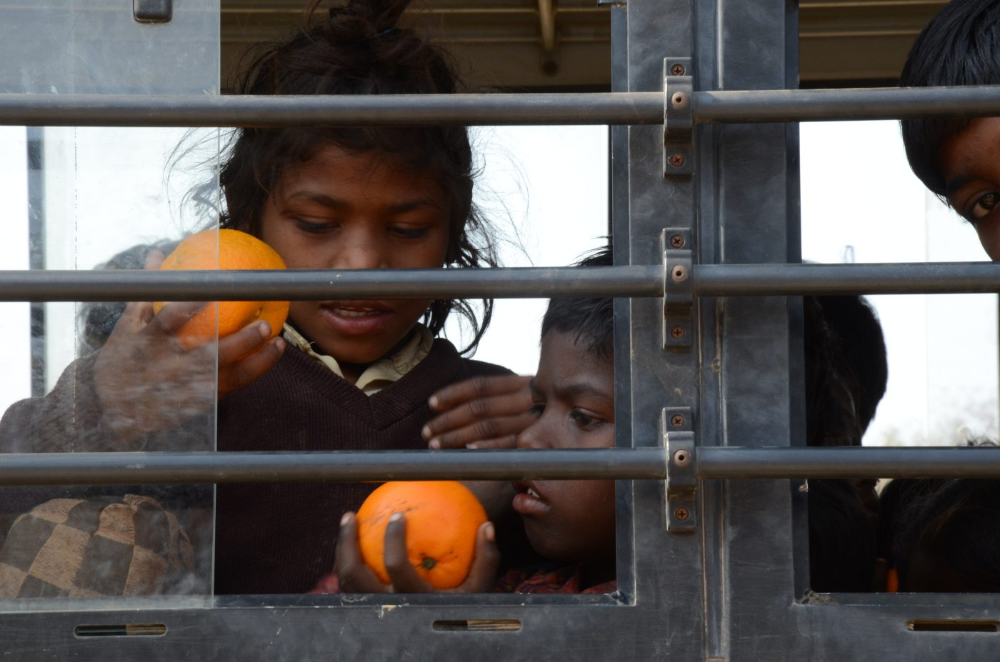

[[Publicado en eduforics.com](http://www.eduforics.com/es/abp-y-justicia-social-como-puede-el-aprendizaje-basado-en-proyectos-abp-ayudar-a-cambiar-a-las-personas-que-habitan-este-mundo/)]

*Las cosas estaban cambiando en Balancia, (…) ¡Este jodido siglo sin ton ni son!.*

*Sony Labou Tansi*

Cuando Freire nos decía que “*la educación no cambiará el mundo, cambiará a las personas que lo harán*”, posiblemente, se comprometía con la función más importante que puede protagonizar la educación: cambiar la mirada de las personas e invitarlas a actuar en consecuencia.

Era una visión profundamente humanista que recogía Augusto Boal cuando traducía a términos teatrales la pedagogía del oprimido diciendo que “*todos los seres humanos son actores, porque actúan, y espectadores, porque observan*”.

2020 está siendo un año que la naturaleza ha puesto delante de los ojos de los seres humanos la necesidad de mirar cómo son sus vidas y qué deciden hacer con ellas y el planeta mismo.

Sin duda alguna, la urgencia de la educación es dotar a las personas de la capacidad de analizar críticamente la realidad que tienen delante y remangarse -colectivamente- para mejorarla. Esto no puede hacerse desde la *escuela-del-simulacro*.

**¿Qué es la** ***escuela-del-simulacro*****?**

Permíteme que te describa dos tipos de “*problemas*” que se pueden plantear contar tus a tus alumnos en una clase:

*Supongamos que un avión sale de Bruselas a Madrid a una velocidad de X kms/h. y otro de Madrid hacia Bruselas a Y kms/h. ¿en qué momento se cruzarán?*

*Supongamos que un camión lleno de galletas belgas sale de Bruselas hacia Madrid para ser consumidos aquí y otro camión de torrijas españolas sale de Madrid con dirección a Bruselas ¿Qué coste energético y de vertido de CO2 a la atmósfera supone esta operación comercial? ¿En qué momento se cruzan los camiones? ¿qué crees que comentan los transportistas? ¿qué crees deberían comentar? ¿Por qué?*

El primer planteamiento lo llevo escuchando en las escuelas desde que yo mismo era un alumno. El segundo es el que puede situar al aprendiz en la necesidad de manejar contenidos curriculares -de matemáticas, lengua, historia, ciencias naturales, etc.- para comprender la realidad que habita y decidir que hacer con ella. Aún seguimos esperando que estos “*problemas*” sean los que presidan la enseñanza en la mayoría de las escuelas del mundo.

El currículo escolar reproduce de forma obscena la injusticia social. Es más, la evaluación es un elemento profundamente injusto ya que determina de forma absoluta los aprendizajes que se valorarán por los estudiantes como relevantes o accesorios[1].

La *escuela-del-simulacro* es la que no se plantea todo esto. La que reproduce de forma irreflexiva un modelo de desarrollo cada vez más desigual. La que vuelve la espalda a la realidad que habitan el noventa por ciento de los ciudadanos del planeta pensando -irracionalmente- que los contenidos que reproducen en sus clases, el modelo de evaluación o la relación que establecen con los alumnos -y con el resto de los miembros de la escuela-, responde a criterios de objetividad y rigor aséptico.

**¿Cómo educar desde la realidad?**

Malaguzzi decía que “*solo es posible educar en la realidad desde la realidad misma*” tenía razón. El simulacro es mal libro de texto. Y lo es por dos razones:

· Porque sitúa el contenido del aprendizaje lejos de la realidad del aprendiz.

· Porque reproduce un escenario social, natural y humano que no existe en la realidad ya que deja fuera los elementos mas importantes sobre los que es urgente el alumno piense críticamente y en torno a los que decida una acción comprometida.

El aprendizaje es un proyecto al que se suman los alumnos -y las escuelas y barrios dónde habitan- en el que los contenidos deben servir -antes que nada- para provocar la mirada de la realidad que tienen delante y decidir actuar sobre ella en términos de justicia social.

Proyectos que tienen **tres dianas** -con Fraser[2]- sobre las que construir sociedades cada vez más igualitarias donde viven personas -cada vez- mas felices.

· La primera son los proyectos educativos que abren la mirada en la **redistribución** de la riqueza tanto en lo macro como en lo cercano al alumno. Las desigualdades en relación con el acceso a bienes necesarios, los espacios naturales, el empleo, sanidad, educación, etc.

· La segunda, aquellos proyectos que ponen el foco en la necesidad de **reconocimiento** del otro. La diferencia de género, cultura, creencias, etc. como valor de crecimiento interpersonal.

· La tercera es la **participación**. El acceso a la toma de decisiones. A que la voz de cada alumno sea escuchada y que los procesos de participación sean reales.

Estos son los ejes que construyen un modelo de aprendizaje basado en proyectos reales y comprometidos con la justicia social.

Poco después de escribir estas líneas he podido ver un fantástico vídeo de Noam Chomsky -en el contexto de encierro por el COVID-19- explicando claramente la necesidad de hacer que los proyectos educativos construyan experiencias de aprendizaje ricas y que reúnan la capacidad de construir ciudadanos competentes y comprometidos[3]:

Si duda, la justicia social tiene que ver con la capacidad de mirar la realidad desnuda. Es el ABP el marco didáctico que permite construir aventuras de aprendizaje en los que se obliga al alumno a mirar la realidad que habita y actuar sobre ella.

**Vivir la aventura del aprendizaje: historia de algunos años de educación**

Hace algunos años me dedico a la formación de educadores y educadoras. Las materias que estos futuros profesionales deben cursar son variopintas y -posiblemente- todas necesarias. Sin embargo, siempre he creído que la formación se quedaba huérfana si no se les ofrecía la posibilidad de **enriquecer la mirada** y **actuar de forma real** como educadores.

Para mirar y actuar hace falta habitar la realidad y abandonar el simulacro y a eso llevo años dedicando los proyectos que propongo a mis alumnos. Esto ha ido creando una interesante red de centros, iniciativas y personas que me han facilitado la labor. Debo dar las gracias a todas ellas.

Recuerdo a Chus Balo -director hace años- de una pequeña escuela que luchaba por defender la diversidad en su centro y con el que hicimos proyectos tan interesantes como “*el muro de la diversidad*” o, años atrás, al *festival de cine de Iruña*que fue testigo de proyectos que luego fueron reconocidos con premios a artes escénicas como “*gnro mjr*”. Espacios de creación colectiva en las *Escuelas de Valores* con mi querida amiga Esther Monleón que -en Málaga- estuvo mas de diez años apostando por el arte, la educación y la creatividad como estrategias de aprendizaje. O el *Festival de arte, educación y acción social* que supuso una apuesta importante para intentar encadenar a todo un centro en una apuesta que pudiera dotarle de una identidad comprometida con el cambio y no solo con la reproducción de contenidos anodinos. Lo conseguimos solo en parte.

El *Centro de la mujer de Cabanillas* -en Guadalajara- donde trabajamos colaborativamente un par de años con educadores en formación. El *Centro penitenciario de Valdemoro* en el que pudimos desarrollar talleres con jóvenes reclusos acompañados por la monitora ocupacional. Y tantos otros…

Junto a estos, varias decenas de centros de educación infantil, primaria, secundaria, formación profesional, adultos y universidad a los que pude llevar grupos de educadores en formación y que desarrollaron proyectos conjuntos con los que nos nutrimos todos y todas. La lista sería interminable.

En los últimos diez años he tenido la suerte de poder desarrollar un proyecto que se repite de forma continua y lleva a grupos de docentes en formación al Atlas. La idea es que intervengan directamente en escuelas en las que las condiciones educativas, sanitarias y físicas son precarias. También que habiten esa realidad una decena de días. Es el proyecto “*El péndulo de Ifoulou*” que tiene más recorrido del que puedo contar aquí y del que acaban de estrenar un documental emocionante exalumnos del *CIFP Jose Luís Garci* de Alcobendas (Madrid) quienes nos acompañaron hace un par de años[4].

Hace unas semanas hemos regresado de India con otro grupo de docentes en formación para trabajar en terreno con niños y niñas empobrecidos y excluidos. La casta de los “*intocables*” -que sigue existiendo en la realidad- y habitan en condiciones inhumanas en empresas ladrilleras que les explotan de sol a sol.

Esta necesidad de cambiar la mirada y provocar que los docentes actúen en consecuencia nos ha llevado a promover distintas organizaciones para las que el sistema educativo formal no parecía dar cabida. Asociaciones como la *Asociación PSii* o últimamente **LABinE** que apuesta por una iniciativa que nos compromete: LAS ESTANCIAS FORMATIVAS[5]que crecen desde Marruecos a India, Madrid a Extremadura y viajan en próximas ediciones bastante más lejos.

También para acompañar -y promover- el desarrollo de redes de centros que apuestan por la educación por la Justicia Social como la red de *Escuelas Hermanadas por la Justicia Socia*l y apoyar decididamente la creación y desarrollo de la *Cátedra UNESCO de la Educación para la Justicia Social*[6].

Los proyectos (ABP) deben ser capaces de cambiar la mirada de los alumnos e invitarles a actuar sobre la realidad. Para hacerlo es necesario trabajar en la realidad misma.

-------

[1] McArthur, J. (2019*): La evaluación: una cuestión de justicia social. Perspectiva crítica y prácticas adecuadas.*Madrid, Narcea
[2] Fraser, N. (2008): “La justicia social en la era de la política de identidad: redistribución, reconocimiento y participación”. *Revista de Trabajo*, 2.6. pp. 83-99 [trabajo.gob.ar]
[3] <https://www.youtube.com/watch?v=OEdfJP9S4NE>
[4] <https://www.cinetecamadrid.com/programacion/dentro-del-pendulo>
[5] Ver [labine.org](http://labine.org/) . En el caso de la estancia en India puedes ver [estanciasformativas.wix.com/india](http://estanciasformativas.wix.com/india)
[6] Ver <http://www.escuelasxjusticiasocial.org/> y <http://www.catedraeducacionjusticiasocial.org/>
