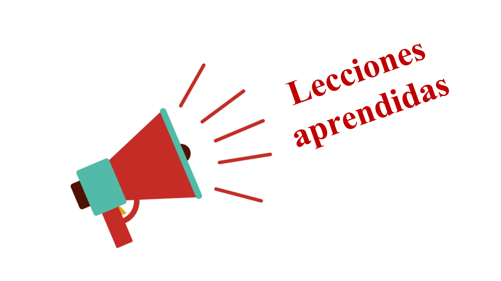

[**[Publicado en Periódico Escuela]**](http://www.periodicoescuela.es/Content/Documento.aspx?params=H4sIAAAAAAAEAMtMSbH1czUwMDAyNDc0MTNRK0stKs7Mz7M1MjAyMDAzNFTLy09JDXFxti3NS0lNy8xLTQEpyUyrdMlPDqksSLVNS8wpTlVLTcrPz0YxKR5mAgD82U4aYwAAAA==WKE)

*La vida es una sucesión de lecciones que deben vivirse para ser comprendidas.*

*Helen Adams Keller*

Hemos tenido un último trimestre del curso que pasará a la historia como un desafío no conocido hasta la fecha tanto para los docentes, los centros, las administraciones educativas, las familias y los propios alumnos y alumnas.

La reclusión del planeta ante la emergencia sanitaria ha dirigido la mirada hacia las tecnologías de la conectividad como las únicas herramientas disponibles para permitir la relación entre docentes y su alumnado. La urgencia ha sido terminar el curso de la mejor manera posible y esto ha supuesto una gran dedicación de todos. También algunas lecciones que podemos reconocer en nuestro modelo de desarrollo educativo.

En líneas generales COVID-19 ha funcionado como una lupa de aumento que ha permitido hacer ostensiblemente visibles los desajustes de nuestro modelo educativo. También dibujar algunos caminos por los que transitar en adelante.

**Lección 1:** La pandemia ha hecho especialmente visible la profunda desigualdad de las personas con relación a sus derechos básicos -entre ellos la educación-. En este momento citaré -solamente- el acceso a la conectividad. Esta es muy desigual en el planeta. Las diferencias entre los países del norte y el sur son escandalosas. Estas diferencias son similares a las que podemos constatar entre distintos barrios de una ciudad europea. Los barrios empobrecidos disponen de conexiones escasas. *Parece que se estabiliza la idea de que, entre comer y hablar por el celular, las personas priorizan la supervivencia.*

Pero más escandaloso es el uso que se da a la conectividad. Esta se doblega al comercio, los intereses de control y conocimiento de nichos de consumo y el aumento de los almacenes de *big data* en espera de la incensante formulación *algoritmos* que permitan a las empresas enriquecerse incesantemente gracias a estos datos que ofrecemos de manera inconsciente en cada segundo de utilización de aplicaciones gratuitas, de movilidad, búsqueda, etc.

El uso, supuestamente, educativo que se da a las aplicaciones y redes de conexión no tienen demasiado que ver con el compromiso con la *innovación didáctica*. Más bien, se asocia este término al de *innovación tecnológica*. El cambio en educación asociado a la adquisición de competencias de pensamiento crítico para comprender y habitar el mundo que vivimos en el siglo XXI es escaso. Más bien nos encontramos con modelos nuevos que siguen apostando por la reproducción como fin último de la educación.

**Lección 2:** El final del curso ha necesitado de un pacto entre las familias y las escuelas. Los docentes han realizado un esfuerzo inmenso para atender a sus alumnos. Para que sus frutos pudieran desarrollarse ha sido necesario el trabajo cómplice de las familias que ayudaban a sus hijos, creaban un espacio de interés para el aprendizaje, aseguraban la conectividad, etc. Aquellos ambientes familiares que han sido capaces de enriquecer educativamente el entorno han conseguido que sus hijos e hijas pudieran seguir -con mayor o menor acierto- las propuestas de sus profesores. Este también ha sido un gran elemento de desigualdad.

Es necesario entender que la educación es tarea de todos y todas. Las escuelas, los docentes, los barrios y las familias. Debe estabilizarse un pacto real entre todos los implicados. También es necesario entender que las posibilidades de aprendizaje no son las mismas en todos los entornos y, por tanto, es necesario extenderla al conjunto de la población.

**Lección 3**: El nuevo escenario de aprendizaje ha hecho visible que la realidad que vivimos no es *ora virtual y ora física*. **Habitamos una realidad híbrida** en la que convivimos de forma natural en un espacio nuevo de relaciones, comercio, aprendizaje, laboral, etc.

El desafío de la educación actualmente no es implementar en nuevas plataformas modelos educativos añejos y basados en la reproducción. En nuestra realidad híbrida la tarea de la educación es conseguir ciudadanos que desarrollen un pensamiento crítico respecto a la misma y sean capaces de actuar sobre ella en términos humanos. Esto es, comprometidos con las personas que lo habitan y el futuro que sueñan.

**Lección 4:** El COVID-19 ha hecho visible que la inercia que se vive por parte de los modelos educativos tradicionales es muy fuerte en distintos grupos de administradores, docentes y familias. Hay importantes grupos de docentes, alumnado, familias y administraciones educativas que han visto reforzada su resistencia al cambio apoyados en este fenómeno.

La apuesta ante los nuevos retos no puede ser la tecnificación de la enseñanza tradicional. Es necesario aprovechar las circunstancias actuales para que se visibilice la necesidad de un cambio paradigmático en los modelos de enseñanza.

**El COVID-19 puede ser una gran oportunidad para apoyar a grupos de docentes innovadores que demuestran que es necesario un cambio de modelo en educación y pasar de un concepto alienado de enseñanza que busca la reproducción y la transmisión hacia un modelo crítico en el que lo prioritario es crear pensamiento reflexivo y el desarrollo de habilidades para habitar la realidad híbrida que vivimos en la actualidad.** Septiembre puede ser una oportunidad para ellos, pero es necesario centrar el foco en lo importante: las personas que habitan la realidad que tenemos. Hay que pensar que la tecnología de la conectividad solo es parte del escenario que vivimos, no el objetivo del mismo.

Reconocer la realidad híbrida como el nuevo espacio vital nos invita a identificar sus potencialidades y también sus problemas: medio ambiente, consumo, tecnologías como espacios no neutros ideológicamente, desigualdad, etc. y también la capacidad que ofrecen los nuevos modelos relacionales, la posibilidad de romper definitivamente el espacio y el tiempo de aprendizaje, conectar lo escolar con la vida, la redefinición del perfil del docente, la apuesta por modelos narrativos de aprendizaje basado en proyectos, el compromiso social como finalidad educativa, etc.
