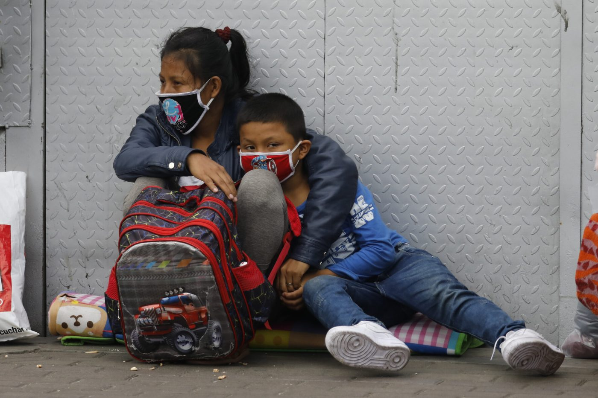

[[Publicado en Periódico Escuela 01/10/20]](http://www.periodicoescuela.es/Content/Documento.aspx?params=H4sIAAAAAAAEAMtMSbH1czUwMDAyNDe2MLRQK0stKs7Mz7M1MjAyMDQwMFTLy09JDXFxti3NS0lNy8xLTQEpyUyrdMlPDqksSLVNS8wpTlVLTcrPz0YxKR5mAgB6-NnzYwAAAA==WKE)

Hace algunos meses salimos de casa y pudimos nutrirnos de vitamina D directamente del sol, sin necesidad de hacerlo en pastillas. El curso había terminado en un enloquecido compromiso de familias, docentes y alumnado para no dejar atrás nuestro deseo de educarnos, aunque sea a costa de digitalizarnos. Comenzamos a hablar de «la nueva realidad» y nos fuimos de vacaciones algunos. Otros —los equipos directivos de cientos de escuelas— tuvieron que adaptar sus espacios dibujando rutas de entrada y salida de los edificios, gel hidroalcohólico en las mesas, división de los alumnos, familiarizarse con ingeniosos términos nuevos como «grupo burbuja», etc.

El inicio de curso no puede decirse que haya sido especialmente tranquilo. Mientras los expertos señalaban la necesidad de limitar los agrupamientos de personas, los centros educativos han debido acoger a cientos de alumnos. No es de extrañar que decenas de docentes vean motivo para salir a la calle y declarar su desacuerdo en forma de huelgas, escritos, denuncias y muestras de un malestar que comparten familias y alumnado a partes igual.

La referencia aducida por las administraciones para las decisiones adoptadas son los criterios científicos. Esto parece muy sensato. Sin embargo, cuando abrimos un diario encontramos que los criterios técnicos, en muchos lugares de Europa, para adoptar medidas contra la pandemia se sitúa cuando la tasa en de 50 o menos afectados por cada 100.000 habitantes, los técnicos del ministerio de educación español lo sitúan en 500 para cada 100.000 y los técnicos de la comunidad de Madrid en 1.000 para cada 100.000. ¿Alguien con un mínimo de honradez es capaz de defender que esos juicios técnicos no responden a presiones políticas?

Desde mi humilde punto de vista, la nueva normalidad no tiene nada de nueva. La India tiene unas tasas extremas de contagio. Los barrios más pobres de las ciudades presentan unos índices de contagio muy superiores al resto. No me atrevo a defender en un medio público que hay decenas de personas que creen que el miedo de los barrios ricos al contagio se debe a que sus hogares, sus mecánicos, quienes limpian sus aceras y les sirven los cafés viajan a diario en transporte público procedente de los barrios más contaminados, pero creo que hay muchas personas que piensan esto. Sus argumentos no son despreciables. No puedo dejar de pensar en la maravillosa viñeta de El Roto de hoy 1 de octubre https://elpais.com/opinion/2020-09-30/el-roto.html.

*«Desde mi humilde punto de vista, la nueva normalidad no tiene nada de nueva. La India tiene unas tasas extremas de contagio. Los barrios más pobres de las ciudades presentan unos índices de contagio muy superiores al resto»*

En el plano educativo la cosa no difiere mucho. Las plataformas digitales que se usan —en una gran mayoría— responden solo a rutinas de aprendizaje clásicas en las que el profesor transmite conocimientos, requiere tareas a sus alumnos y las evalúa con vistas a la rendición de cuentas exclusivamente. Demos gracias a que hay otro muchos que investigan, juegan y se «buscan la vida» como pueden para seguir en la brecha de la innovación, pero son una minoría. La nueva realidad está haciendo el juego a la vieja realidad: se asientan modelos tradicionales de aprendizaje sobre la excusa de que no es posible, que es complicado y que la urgencia es dotar al profesorado y alumnado de «*competencia digital*». No estoy de acuerdo.

Creo que esta realidad no hace más de dibujar una lupa de aumento sobre la que ya habitamos desde hace décadas. La desigualdad en el acceso a los bienes básicos se está acrecentando en esta pandemia.

En el ámbito educativo esto es visible. No todos tienen el mismo acceso a los recursos tecnológicos, ni la capacidad de espacios cómodos de aprendizaje en sus viviendas. Sus familias no están sometidas de igual forma a la presión del empleo —lo que explica en parte la negación radical de decenas de vecinos del vallecano barrio de Madrid a realizarse pruebas PCR que si dan positivo les obligará a confinarse en casa con la idea cierta de perder su puesto de trabajo, recursos para alimentarse, vestirse y mucho más… por ejemplo, tener conectividad para sus vástagos estudiantes online—.

La desigualdad es la pandemia. Solo un decidido esfuerzo por apoyar las redes de apoyo institucional y social en relación a servicios de salud, redes de aprendizaje y garantía de condiciones mínimas vitales dignas, serán las que luchen contra la pandemia. El resto es solo humo político. Algo que ya saben los ciudadanos y los políticos deberían escuchar.
