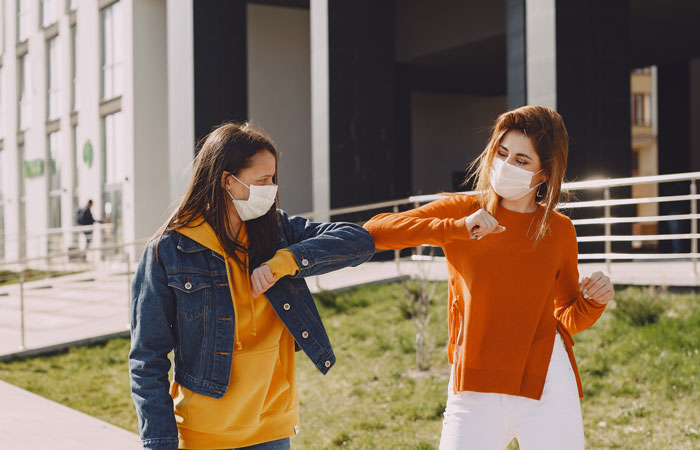

[[Publicado en Periódico Escuela en noviembre 2020]](http://www.periodicoescuela.es/Content/Documento.aspx?params=H4sIAAAAAAAEAMtMSbH1czUwMDAyNDexMLdQK0stKs7Mz7M1MjAyMAQCtbz8lNQQF2fb0ryU1LTMvNQUkJLMtEqX_OSQyoJU27TEnOJUtdSk_PxsFJPiYSYAAIH56wBjAAAAWKE)

El virus ha provocado directamente algunas cosas, otras no. Hace meses que hemos aprendido términos nuevos como ”grupo burbuja”, “confinamiento perimetral”, “rastreadores”, “nueva normalidad” y tantos otros. Este afán por poner nombres a imprevistos incómodos no es nuevo. Desde hace años en vez de “explicar las cosas” se pide que se haga “pedagogía” -no sabía yo que en eso consiste esa ciencia, pero claro, solo soy pedagogo; no político-. Llevamos algunos años que hemos dejado de escuchar que alguien difunde una “noticia falsa” porque parece mucho más glamouroso decir que protagoniza un “fake news”. Así que nos hemos instalado en una realidad que solo habitan quienes protagonizan las modas terminológicas que parecen explicar las incomodidades que les inquietan. Una de ellas es la extensión de un virus.

La COVID-19 no es más que la pandemia producida por un virus. A mi corto entender resulta difícil escuchar continuamente frases que aseguran que la covid tiene la culpa del aumento del paro, la recesión económica, el retraso escolar, el aumento de la desigualdad, etc. Disiento radicalmente; covid-19 no es más que la extensión de un virus. La desigualdad, la pobreza, la necesidad de nuevos modelos de desarrollo, la necesidad de acabar con la pobreza, el acceso a los bienes de consumo, educativos, sanitarios, etc. no las protagoniza el virus. Este no es más que una **lupa de aumento** que nos pone delante de la mirada una realidad incómoda en un modelo de desarrollo al que parece solo existe la respuesta de culpar a un virus -o inventar términos nuevos- para realidades que incomodan a quienes tienen en sus manos girar radicalmente el modelo de progreso y trabajar para la igualdad y la justicia.

Podemos hablar de muchos de estos incomodos escenarios que nos rodean. Uno de ellos -que me preocupan especialmente del verano aquí- es el de la culpabilización de la extensión de la pandemia a los jóvenes. Y cuándo hablo de los jóvenes, me refiero a los que conozco y con quienes trabajo a diario. En los últimos días asistimos perplejos escenas de violencia importante. Se escucha que son “los jóvenes”. No serán -desde luego lo que van a mis aulas, a las asociaciones ciudadanas, los que deciden limpiar la ciudad o acuden prestos ante cualquier necesidad socomunitaria. Si extenderme especialmente en este asunto, no estaría de más recordar la metáfora de la violencia como un Iceberg en congruencia con la nada novedosa mirada de Galtung. Tanta rabia en la mirada, la capacidad de unir ideologías irreconciliables, etc. nos invita a pensar que habrá también que empezar a bucear bajo la superficie del agua para reflexionar de una manera más inteligente en torno al fenómeno. Pero este artículo pretende hablar de esos otros jóvenes que -aún así- se han visto acusados de ser la vía de transmisión del virus.

No digo yo que las fiestas, la socialización indiscriminada, las faltas de cuidado, ignorancia sobre los riesgos y la preocupación por los temas que les son propios en la edad; no sean causa de decenas de reinfecciones. Lo que me preocupa muy especialmente es que -noticia tras noticia- la causa de la extensión de la pandemia la protagonizan ellos. Esto además de falso es una estrategia realmente peligrosa.

Eliminar la extensión del virus exige comprometerse con comportamientos sociales, educativos y económicos absolutamente contradictorios con el modelo de progreso actual. La red de servicios sanitarios, educativos y asistenciales se ha desmantelado en las últimas décadas en muchos países. Los modelos de progreso económico dejan de tener sentido en una situación en la que la amenaza a los ciudadanos es inminente. Dicho de otra forma: dejemos de hablar de dineros y hablemos de personas.

Los debates políticos avergüenzan a todos los ciudadanos -sean de la orientación política que sean-. Todo el mundo lo tiene claro: ¡esto es una vergüenza!; es necesario que alguien diga estas palabras y comience a trabajar poniendo a las personas en el centro.

Los jóvenes no son el problema, son las primeras víctimas de una situación a la que los estados no están sabiendo hacer frente. Ellos supieron confinarse cuándo se les pidió en un primer momento. Decenas de ellos han organizado redes de ayuda en barrios y colectividades. Ellos son los que llenan nuestras residencias de mayores arriesgándose a contagios para cuidar a quienes más desprotegidos están. Asumen empleos en precario que les exponen a todo tipo de riesgos. Los jóvenes están dispuestos a participar, pero necesitan que comprendamos que las condiciones de la participación ya no son las mismas que hace tiempo. Alguien deberá explicarlo; o dicho en términos actuales: “hacer pedagogía”.

Participar, hoy, exige asumir un compromiso a la vez que la posibilidad de participar- colaborativamente- en la creación la propia convocatoria a la que se suman con entusiasmo. Los jóvenes no van a sumarse ciegos a una convocatoria publicada por políticos, empresarios o adultos que no les dejarán participar efectivamente de ella. Mucho menos si les ven en cenas sin mascarillas ni distancia de seguridad. Así solo se quedarán en sus casas, retornarán a sus fiestas, su escepticismo en relación al mundo adulto, su porvenir o el papel que se les permite jugar en la sociedad.

**Ahora bien, dejen a los jóvenes que protagonicen la ayuda. Inviten a los jóvenes a que dirijan la mirada de las personas que sufren la pandemia. Pidan a los jóvenes ayuda para que colaboren en los barrios, las comunidades, las escuelas y los servicios sociales y es seguro se sorprenderán.** Dicho de otra forma; es necesario alejarse del modelo de enfrentamiento y oposición para construir el modelo de colaboración y empoderamiento.

Hablemos de educación. Os invito a que visitéis mis clases -con decenas de jóvenes- y preguntadles si están dispuestos a arrimar el hombro en esta situación. Dirán que si. También os dirán que también quieren poder participar en un modelo de ayuda que luego no les deje en el olvido, el paro o la desconfianza. No quieren otra cosa que lo que exigimos todos: respeto.
