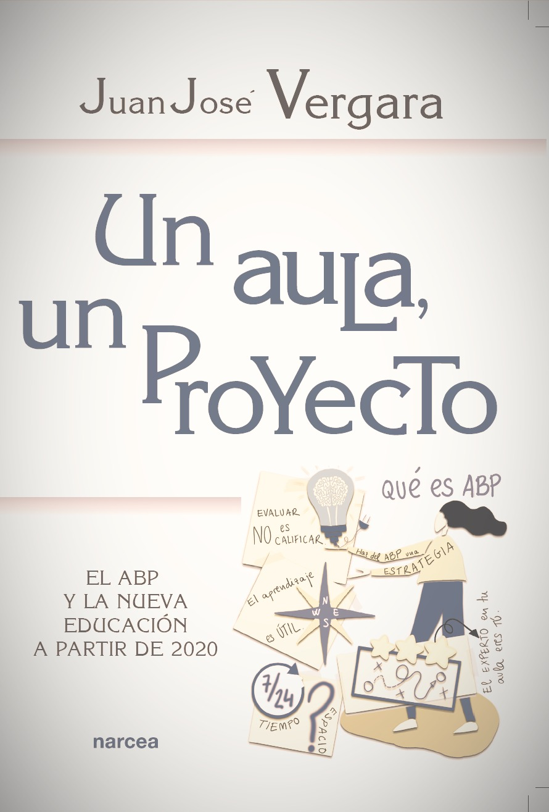

[[Publicado en Prensa Libre. Guatemala. junio de 2021](https://www.dropbox.com/s/bzd1b1xp6xrnfxl/Prensa%20libre%20Guatemala%20250621.png?dl=0)]

**Un ordenador no cambia la enseñanza. Lo hacen los docentes que la lideran.**

Recientemente ha sido publicado mi último trabajo sobre Aprendizaje Basado en Proyectos (ABP) en la editorial Narcea: ***Un aula un proyecto. EL ABP y la nueva educación a partir de 2020***. Un libro que sale a la luz tras dos años de aulas prácticamente vacías. Tuve el honor de poder presentarlo en *la Cumbre de Educación 2021* en Guatemala organizado por el grupo PiedraSanta[[1]](https://manage.wix.com/dashboard/500c7db6-2c2d-48bd-a8a1-f97ae231025d/blog/create-post?compId=kqjdr8ub&origin=gfpp&viewMode=editor&appDefId=14bcded7-0066-7c35-14d7-466cb3f09103&origCompId=TPASection_k8r69026&lang=es#_ftn1)

Cuando se conoció la amenaza que suponía el virus, las escuelas del planeta debieron cerrar sus puertas y el aprendizaje quedó relegado a la única esperanza que existía en manos de los docentes: la tecnología. La necesidad de prolongar las experiencias de aprendizaje a los domicilios confinados del alumnado depositó en Internet y los dispositivos electrónicos la esperanza de terminar el curso en condiciones preocupantes: mascarillas, alejamiento social, organización de grupos-burbuja, confinamientos y utilización masiva de herramientas telemáticas.

Desde este momento todas las voces anunciaron un cambio radical en la enseñanza. Muchos de ellas redoblaron el interés por la *tecnoeducación* como futuro cierto. Prácticamente todas las administraciones educativas del planeta aumentaron significativamente sus presupuestos para invertir en la dotación a centros, docentes y aprendices de recursos informáticos. Sin duda es una buena noticia. Es necesario incrementar los recursos técnicos a disposición de la enseñanza, pero no es este el único cambio que necesita la educación. La tecnología ha facilitado algunos procesos de comunicación en la pandemia, pero también se ha erigido como un elemento importante de desigualdad entre las personas, las regiones del planeta e incluso los barrios de una misma ciudad.

Es un gran error pensar que la enseñanza, el trabajo o las relaciones personales pueden quedar relegadas a la red. También lo es pensar que estas son ajenas a la realidad que vivimos. La realidad que habitamos es profundamente híbrida. La tecnología y la conectividad se han integrado de forma natural en nuestras vidas. El reto es conseguir que estas no se conviertan en un elemento de exclusión. La discusión no es, simplemente, incrementar los recursos tecnológicos en las escuelas. El cambio en la educación vendrá gracias a la reflexión de sus profesionales sobre cómo planificar sus clases, cómo desarrollar experiencias de aprendizaje útiles y contextualizadas y cómo emplear la evaluación como una herramienta de aprendizaje y no de exclusión. **El cambio vendrá de la mano de los expertos en educación: los docentes. Y no de las redes, las máquinas o los recursos**. Hace algunos meses escribía un pequeño trabajo sobre “***el espejismo de la tecnoeducación***” en el que desarrollaba esta idea[[2]](https://manage.wix.com/dashboard/500c7db6-2c2d-48bd-a8a1-f97ae231025d/blog/create-post?compId=kqjdr8ub&origin=gfpp&viewMode=editor&appDefId=14bcded7-0066-7c35-14d7-466cb3f09103&origCompId=TPASection_k8r69026&lang=es#_ftn2).

**Los fines de la educación siguen intactos**

Vivimos un mundo profundamente desigual en el que el lugar de nacimiento de cada persona determina de manera inconcebible su presente y su futuro. También lo hacen las diferencias de género, creencias, identidad, etc. Estas diferencias se han acrecentado en estos últimos años.

La enseñanza debe cambiar. Los modelos reproductivos del pasado no trabajan a favor de una educación orientada a las personas que han de construir un mundo cada vez más habitable. Esto obliga a entender algo; la hibridación de la realidad humana no debe alejarnos del objetivo que nos compete en educación: educar la mirada de los aprendices en torno a su realidad cotidiana y dotarles de herramientas necesarias para hacerla más humana.

La educación como instrumento para mejorar las personas que aprenden, su contexto, su presente y su futuro. La igualdad, la justicia social, la inclusión, la participación efectiva en la toma de decisiones, el compromiso con los otros y la comunidad son los fines de la educación, antes y después de 2020.

**El Aprendizaje Basado en Proyectos es un marco para el cambio de nuestras escuelas**

Cada territorio posee diferencias importantes en cuanto a la realidad en la que debe desarrollarse la enseñanza. Algunos lugares presentan domotizados edificios con grupos flexibles de 15 alumnos y grandes recursos técnicos y humanos. Otros se desarrollan en masivas clases de 50 o 60 alumnos en condiciones de escasez de recursos. Algunos ni siquiera tienen un tejado dónde cubrirse del sol y la lluvia. Suelen ser escuelas en entornos rurales o suburbiales con grandes carencias. En todas ellas hay docentes que saben mirar la realidad que tienen delante. Sobre ellos recae la responsabilidad de implementar una gran cantidad de contenidos que saben alejados de las vidas de su alumnado. La evaluación se erige como una herramienta de exclusión. Administradores, familias e incluso los propios alumnos recelan de modelos alejados de la tradición. Sin embargo, los docentes saben que el modelo de enseñanza que hemos heredado hasta 2020 no se ha demostrado capaz de desarrollar en los aprendices aquello que puede hacer de la educación una herramienta de excelencia: dirigir la mirada a las personas que habitan este híbrido mundo y desarrollar habilidades de pensamiento crítico, creativo y ejecutivo que les ponga en el camino de hacer de este un mundo mejor. Empezando por sus vidas, las de sus seres cercanos, sus comunidades y su región geográfica.

El Aprendizaje Basado en Proyectos (ABP) reúne bastantes de las características que pueden ponernos en la senda de aprovechar la crisis de 2019 y convertirla en un cambio radical sobre: qué enseñamos, cómo lo hacemos y cuáles serán las consecuencias en la construcción de un mundo más justo y habitable. En definitiva, volver hacia una mirada ética del hacer educativo.

**Los proyectos que cambian la enseñanza.**

Tras años visitando escuelas que han implementado el ABP puedo asegurar que sólo algunas de ellas han sido capaces de demostrar un cambio efectivo en la forma de enseñar. Esto me ha llevado a interrogarme sobre cuáles son las características que debe reunir el ABP para que sea motor de cambio en las escuelas. Esto es algo que las distintas administraciones y países exploran con mayor o menor éxito. El ABP puede ser motor del cambio necesario en las escuelas para hacer efectiva una enseñanza de calidad y adecuada a la realidad que vivimos en la actualidad. El desarrollo de competencias básicas, las habilidades necesarias para construirlas y la capacidad de los contenidos curriculares de cada etapa educativa para servir a la construcción del aprendizaje debe verse acompañado del diseño inteligente de experiencias de aprendizaje en las que el alumnado utiliza los contenidos curriculares para comprender mejor la realidad que habita, su contexto cercano, las personas que le rodean y sus sueños como motor de la creación de un itinerario de aprendizaje que le recorrerá toda su vida.

El ABP que me interesa debe ser un marco útil para que los docentes puedan trabajar sobre los imperativos de su realidad -contenidos curriculares, entorno sociocultural, recursos disponibles, etc.- y sirva para dar una respuesta comprometida a los mismos. Debe garantizar la excelencia de los aprendizajes. Es necesario que permita repensar el papel del docente haciendo que pase de ser un transmisor de contenidos a un provocador de experiencias de aprendizaje. Debe romper radicalmente las fronteras del espacio y el tiempo haciendo que las escuelas se relacionen de forma normalizada con el resto de los recursos educativos y comunitarios del entorno -para ello puede ser interesante la tecnología si es un recurso que acerca e iguala a las personas y no excluye-. El ABP debe reencontrarse con la narratividad como recurso estrella del diseño didáctico. La evaluación debe centrar sus esfuerzos en el desarrollo de rutinas de reflexión sobre lo aprendido que permitan al alumnado aprender gracias a ellas y no ser simplemente etiquetados con una calificación que les aparta o encumbra en un itinerario de aprendizaje que poco dice de ellos.

En definitiva, el ABP puede ser un motor de cambio y mejora escolar si atiende cuidadosamente a las características que le hacen una herramienta potente para la enseñanza. No es de extrañar que decenas de países apuesten decididos por implementarlo en sus modelos educativos liderando cambios metodológicos en sus escuelas.

---
[[1]](https://manage.wix.com/dashboard/500c7db6-2c2d-48bd-a8a1-f97ae231025d/blog/create-post?compId=kqjdr8ub&origin=gfpp&viewMode=editor&appDefId=14bcded7-0066-7c35-14d7-466cb3f09103&origCompId=TPASection_k8r69026&lang=es#_ftnref1) <https://youtu.be/VcEM2vU_1vc>
[[2]](https://manage.wix.com/dashboard/500c7db6-2c2d-48bd-a8a1-f97ae231025d/blog/create-post?compId=kqjdr8ub&origin=gfpp&viewMode=editor&appDefId=14bcded7-0066-7c35-14d7-466cb3f09103&origCompId=TPASection_k8r69026&lang=es#_ftnref2) <https://bit.ly/3vCViv3>
