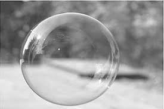

Cuando Nerea atraviesa el umbral de la escuela se sabe una persona importante. Al llegar los adultos la saludan sonrientes. Son las madres o padres de sus amigos del cole. La puerta de entrada está llena de colores y dibujos que la gustan. Al entrar en su clase, su maestro la llama por su nombre y da los “*buenos días*” amablemente.

Tras dejar el abrigo en la percha correspondiente, se sienta en el suelo haciendo un círculo con sus compañeros y compañeras de clase. Tan solo una cabeza destaca por la altura del resto de personas que configuran este grupo. Su voz de adulto indica que es el profe y una por una son invitadas a decir cómo se sienten hoy. Si han dormido bien. Qué han soñado y si están dispuestas a emprender un día de trabajo en la escuela.

A lo largo del día dibujan, escriben, juegan. Hacen actividades individualmente, en pequeños grupos, parejas o en conjunto. Votan propuestas y anotan los resultados. También emprenden tareas desafiantes con libros, fichas o murales.

Una de las cosas que más gusta a Nerea es salir al patio y jugar con sus amigos. Esto lo realizan varias veces a lo largo de la mañana. Una dura jornada de trabajo. A lo largo de ella reponen energía con comida y bebida.

Según van pasando los años, Nerea va cambiando de compañeros y también de profesores. Comprueba que cada uno de ellos es distinto y que sus clases también lo son. Poco a poco descubre que hay diferencias entre los números y las letras. Las materias se van diferenciando cada vez más y algunos años son más divertidos que otros. Sus intereses van cambiando, sus amistades también y la forma cómo se desarrollan sus clases se diferencia mucho de cuando comenzó en Infantil. Pero hay algo que permanece invariable.

A lo largo de todos estos años, sus maestros y maestras, compañeros y sus familias han defendido siempre algunos valores constantes. La naturaleza es un bien importante y hay que respetarla. La violencia no es una forma aceptable de relación y el diálogo debe imperar entre todas las personas. Es importante ser capaz de ser solidaria y respetuosa con el resto de personas. Todas somos iguales en cuanto a derechos y opiniones. Es importante escuchar al otro. Las decisiones deben ser tomadas de forma colectiva y la razón es la mejor herramienta para convivir. El objetivo más importante en la vida es ser capaces de ser felices todos y todas juntas. El conocimiento nos ayuda a conseguir la felicidad. El esfuerzo colectivo es una herramienta poderosa para conseguir objetivos de progreso. La vida es el bien más preciado que tenemos. El amor y el compromiso con la comunidad en que se vive, los grupos familiares y de relaciones dibujan la esencia misma de progreso. Compartir es mejor que competir. Aplastar, violentar, imponer, destruir son algunos de los verbos que no residen en los valores que Nerea lleva escuchando cada día, en la escuela, a lo largo de los años.

Cuando Nerea deja la escuela todo cambia y se sumerge en un mundo lleno de competitividad, en el que el medio ambiente es amenazado a diario, la violencia es visible en el día a día y los medios de comunicación. No siente que las decisiones se toman colectivamente. La individualidad impera más que la colectividad y el progreso se define en función de la riqueza que se posee y no las tareas que se construyen colectivamente.

La familia de Nerea sabe que cuando ella termine la escuela deberá integrarse en un mundo con valores muy distintos a los que han presidido su educación. Sueñan con que la generación de Nerea sea capaz de construir un mundo en el que presidan los valores que se narraban en su escuela, pero cuando está en los últimos años de su escolaridad piden a los maestros y maestras de Nerea que también “*la preparen para la vida”.* Cuando dicen esto quieren que Nerea sea capaz de competir en un mundo como el que saben deberá integrarse. Un mundo presidido por la individualidad, la competitividad, la riqueza económica y la ceguera más absoluta sobre el otro o el medio ambiente.

Freire decía que la educación puede cambiar a las personas que cambiarán el mundo. Mandela hablaba de ella como el arma más poderosa para el cambio. Difícilmente sucederá esto si las paredes de la burbuja son cada vez más gruesas y los valores que hay dentro de ellas no se convierten en revulsivos para toda la comunidad.

Es la educación la que puede comprometer a las personas con el planeta, el diálogo, las relaciones, la paz, la equidad, el respeto, etc. Para ello es necesario que sucedan dos cosas:

1.- La educación es la única arma que disponemos para crear un modelo de desarrollo que ponga a las personas en el centro.

2.- El objeto de la educación son la comunidad entera y no solo las escuelas y los niños y niñas que habitan allí algunos años. También lo es todo aquello que sucede y nos preocupa en ellas: la tecnología, la desigualdad, la violencia, la soledad, etc.

Esta es una  forma muy poco tecnicista de entender la profesión del docente, pero que llena las escuelas de los mejores profesionales. Educadoras y educadores que sientan que su trabajo es un acto de compromiso con las personas. Aquellas que buscan construir un concepto de progreso a la medida de las personas y no los dineros, la colectividad y no la individualidad, el respeto a lo que tenemos delante y no su explotación.

La educación solo será capaz de cambiar el mundo si dejamos que su acción se extienda a todos y todas las comunidades del planeta y no solo al interior de ese edificio-burbuja llamado Escuela. La buena noticia es que tenemos las aulas llenas de estos profesionales. Tan solo debemos confiar más en ellas y ellos. También dejar que hagan su importante labor. La necesitamos.
