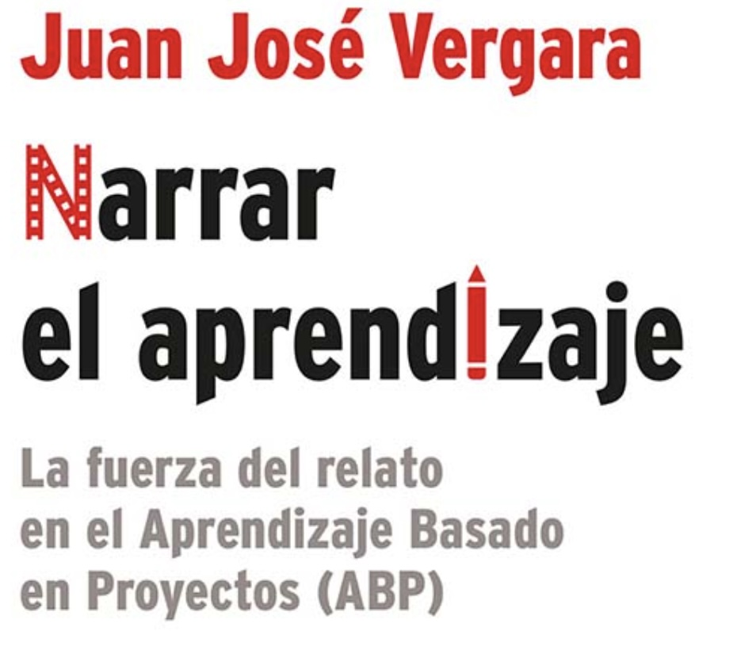

Hace algunos años comprendí aquello que hace que un proyecto educativo sea vivido por el alumnado como algo emocionante: deben vivir el aprendizaje como una aventura. Para hacerlo es necesario que el diseño de tus clases cumpla algunas normas que las doten de una lógica narrativa. A ello dediqué [un libro](https://www.juanjovergara.com/copia-de-aprendo-porque-quiero-1)[[1]](#_ftn1) y sigo pensando lo mismo.

***¿Cuáles son las claves que hacen que una narración tenga posibilidades de interrogar a una persona y provocar el aprendizaje?*** La respuesta a esta pregunta puede situarnos en una dimensión nueva en la forma de diseñar nuestras clases. Es necesario explorar las posibilidades del diseño didáctico para convertirlo en una narración.

Sobre el “*arte de contar historias*” (*storytelling*) hay bastante literatura reciente. Puede ser de interés repasar qué sabemos sobre cómo contar historias en la narrativa, la ficción los medios de comunicación, publicidad o política y aplicar estas claves al diseño de proyectos educativos diseñados como un ABP.

*Para que un relato sea creíble no podemos ceñirnos exclusivamente a la trama argumental. Esta debe convivir con la estrategia emocional, que es la que imprime intensidad narrativa a la historia*. Traducido a términos educativos: debemos recordar que el contenido de la enseñanza es aquello que centra nuestros intereses, pero debemos presentarlos como parte lógica de una trama más elaborada que haga vivir al alumnado una aventura de indagación, acción, relaciones, etc. En definitiva: una aventura.

Son muchas las preguntas que pueden darte ideas interesantes para diseñar tus clases. Algunas de ellas se orientan a los tipos de trama argumental que decidas emplear:

- ¿Qué personajes aparecen en el proyecto? (personas expertas, voluntarias, visitantes, personajes fantásticos, etc.)
- ¿Cómo se relacionan tus alumnos y alumnas con ellas?
- ¿Cómo se establecen las relaciones de los equipos organizados, en torno al ABP que has diseñado?
- ¿Qué conflictos surgen entre participantes del grupo y en la propia trama del proyecto? ¿Cuál es el problema a resolver? ¿Cómo lo resuelven?
- ¿Cómo se vincula emocionalmente tu alumnado a los distintos momentos del proyecto?
- ¿Qué cosas a prenden tus estudiantes que los orientan en relación con el reto al que se enfrentan?
- ¿Qué logros obtienen con sus aprendizajes?
- ¿Cómo lo aplican en su vida cotidiana?

Aprender por proyectos supone entender el aprendizaje como una aventura. Diseñarla es la tarea que tienes como docente. Para hacerlo, que necesario que posea una estructura narrativa correcta. La buena noticia es que hoy día sabemos mucho de cómo se diseñan los relatos.

----------

[[1]](#_ftnref1) Vergara, J. (2018): [*Narrar el aprendizaje. La fuerza del relato en el ABP*](https://www.juanjovergara.com/copia-de-aprendo-porque-quiero-1). Madrid, S.M.-BIE
