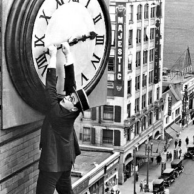

**[Publicado en** [**Cuadernos de Pedagogía**](https://www.cuadernosdepedagogia.com/Content/Documento.aspx?params=H4sIAAAAAAAEAMtMSbH1czUwMDAyMrAwMLRQK0stKs7Mz7M1MjAyMQQKq-Xlp6SGuDjblualpKZl5qWmgJRkplW65CeHVBak2qYl5hSnqqUm5edno5gUDzMBAJUnswRjAAAAWKE) **octubre de 2024]**

- *Ya estamos aquí de nuevo*

- *Si … ¡qué color de piel tienes … has estado en la playa!*

- *Pronto se me quita. A esperar a las siguientes vacaciones.*

- *¿Qué novedades tendremos para este curso? Alguna ocurrencia habrá tenido la consejería en agosto para alegrarnos la llegada.*

- *Como siempre. Yo creo que aprovechan que no estamos para darnos “algún regalito de inicio de curso”.*

-  *A ver qué horarios tenemos….*

- *¡Y qué alumnos nos tocan! .... habrá que aguantar el tirón hasta navidad.*

Hace algunas semanas comenzaba curso nuevo y con él volvieron a llenarse las escuelas. La primera inmersión que vivió el profesorado fue el claustro de inicio en el que todo el equipo se reúne para atender las novedades “*que llegan de arriba*” y que deberá transmitir y hacer cumplir el equipo directivo. Cada vez es más habitual que las normas de inicio de curso lleguen con tiempo suficiente, pero es común que la segunda quincena del mes de agosto “*regale*” instrucciones para su aplicación que traen aparejadas importantes novedades que se suelen traducir en disgustos para directivos y docentes: normativas de prohibición del empleo de móviles, documentos nuevos a elaborar urgentemente, etc.

El primer encuentro entre docentes suele venir acompañado de besos y relatos sobre las vacaciones vividas hasta el día anterior. Las sonrisas presiden este encuentro, pero rápidamente decaen. Mientras caminan hacia la primera reunión del curso las conversaciones van tornando cada vez más pesimistas. Anticipar las malas noticias es algo común en estos preámbulos al curso.

Conscientes de ello, muchos directivos derrochan creatividad en el inicio. Desde prolongar los intercambios informales del equipo ofreciendo un pequeño desayuno a realizar fiestas de bienvenida con juegos y dinámicas grupales.

En cualquier caso, llega el momento de sentarse y realizar la primera reunión del curso. Los docenes miran a los miembros del equipo directivo expectantes. Una mirada parecida a lo que se protagonizará dentro de cada clase, algunos días después, cuando cada docente reciba a su alumnado.

En esta lógica inmersiva nadie parece especialmente emocionado:

El equipo directivo debe poner en funcionamiento el centro cumpliendo las exigencias de inicio de curso que le han llegado “*de más arriba*”.

Los y las docentes se enfrentan con miedo a las “*sorpresas*” que el inicio de curso depara. También a sus horarios, las materias que deberán desarrollar -si es que las cambian cada año- y el alumnado al que deberán atender.

El alumnado anticipa nuevas rutinas que les obligarán a madrugar y permanecer en la escuela bastantes horas al día, la incertidumbre del tipo de docente que les “tocará”, evaluaciones, notas, deberes…. Por no decir la incógnita sobre los compañeros y compañeras con quien deberán vivir todas esas horas.

Las familias han debido acomodar el calendario al inicio de curso. En muchos casos, abuelos y abuelas han debido implicarse -un año más- en atender viajes, comidas y recogidas de sus nietos. También, los esfuerzos económicos que anticipan en compra de material escolar, vestuario, etc. En algunos casos, también ellos son convocados a un primer encuentro de inicio del curso escolar.

En términos generales, todas las reuniones tienen una narrativa parecida con en tres puntos álgidos:

**El primero descubre las “novedades del curso**”. Estas suelen venir de la mano de noticias descritas en términos de normativa o procedimientos de obligado cumplimiento que todos y todas deberán cumplir: los nuevos documentos a elaborar urgentemente por parte de docentes, lo importante y duras que serán las materias de este curso para el alumnado o los “encajes de bolillo” que habrá que hacer para comprar los libros de este año a las familias. Si algo caracterizan estas novedades es que suponen obstáculos que deberán enfrentar en los próximos meses.

**El segundo invitará al optimismo: “Nosotros podemos con todo**”. En una suerte de *alabanza a la cultura del esfuerzo*, el curso es un duro reto al que todos se enfrentan y que deben ser capaces de superar. Así lo recordará el equipo directivo en la reunión de inicio de curso cuando traslade la nueva normativa recibida de la consejería hace -tan solo- algunos días. También será el discurso que tendrá el y la docente tras explicar lo duro e importantes que serán los estudios de este curso a su alumnado. Las familias intentarán reforzar el trabajo de sus vástagos resaltando el esfuerzo que hacen en este inicio de curso y lo importante que será el esfuerzo que hagan para su futuro.

**El tercero impondrá actuar: “Manos a la obra**”, será el mantra que llevará a todos y todas a enfrentar el desafío que se presenta: el equipo directivo tiene que elaborar horarios, poner en funcionamiento el centro, etc. Los y las docentes deben revisar programaciones, preparar sus primeras clases, definir exactamente que deberán conseguir sus aprendices. El alumnado debe cambiar sus horarios, ambientes y enfrentarse a materias nuevas, organizarlas, anticipar exámenes, notas… Las familias despliegan una vorágine actividad: compran materiales escolares, ajustan horarios, viajes, comidas, transportes, etc.

El modelo reproduce un esquema que -con la excusa del “*discurso del esfuerzo*”- sitúa a todos los miembros de la comunidad escolar en una suerte de tragedia que serán capaces de superar. Para hacerlo, deberán esforzarse mucho y dedicar sus energías en emplearse en actividades que -aunque no son las que más desean- permitirán cumplir el anhelado objetivo de “*superar*” el inicio de curso con éxito. Esto los lleva a realizar tareas burocráticas, organizativas, económicas, de gestión de tiempos, de horarios, etc. que no son las que les gustaría hacer en este momento. Pero que, parecen imprescindibles para asegurar el buen comienzo del año académico.

Así vivido, el reencuentro con la escuela no es un acontecimiento deseable para ninguno de sus protagonistas. Tienen ante sus ojos un horizonte del que deberán salir triunfantes. Unos serán capaces de poner la escuela en funcionamiento, otros iniciarán sus clases con todos los trámites burocráticos cumplidos, prepararán su materia minuciosamente, triunfarán con las dificultades que imponga el grupo les toque, aprobarán las distintas asignaturas para pasar al curso siguiente, superarán el mes de gastos extra habiendo comprado todo lo necesario para el inicio de curso y organizado los horarios, entre toda la familia, para que sus escolares asistan al deber de la escuela.

El inicio de curso comienza con la puesta en escena de distintas dificultades que enfrentar y el convencimiento de que todas las personas implicadas serán capaces de superarlas exitosamente. Para conseguirlo, diseccionan los distintos problemas y ejercen acciones directas que prometen ser eficaces: organizar los horarios, elaborar nuevos documentos que la administración de turno solicita, cambiar los hábitos de vida para tener los “*deberes*” a tiempo o preparar la comida del día siguiente de forma anticipada para que el o la escolar correspondiente la tenga preparada al llegar de la escuela. Todo ello tiene -al menos- tres características:

1.        Se presenta en todos los ámbitos de la vida de las personas como una situación problemática y negativa; como una dificultad a superar: en los medios de comunicación, en las relaciones sociales, en las tareas a realizar, en los esfuerzos organizativos y económicos a realizar y en los mismos cerebros de cada persona.

2.        Disecciona los problemas a enfrentar de forma separada, diseñando acciones específicas para cada uno de ellos. No hay mucha posibilidad de enfocar el evento de inicio de curso como un único suceso al que incorporarse.

3.        Exige acciones incesantes para responder a estas dificultades que no dejan tiempo para idear otros escenarios para el acontecimiento colectivo y personal que se avecina.

Estas son las mimbres que tejen el inicio del curso en muchas ocasiones y que ocupan el pensar y el hacer de decenas de personas en este momento.

Por supuesto, no todos los inicios de curso son así. Algunas comunidades reniegan de esta inercia y piensan que **un nuevo curso puede ser una gran ocasión para emprender un fantástico proyecto colectivo**.

Para ellas, el curso es una ocasión de encuentro en el aprendizaje y se niegan a dejar que su atención se centre en las dificultades que enfrentan con el nuevo curso. No las ocultan, pero buscan vivirlas como un reto estimulante que acompaña al aprendizaje.

Así, encontramos cursos que se inician con familias que comparten libros de texto, materiales escolares, grupos intergeneracionales que asumen colectivamente tareas de recogida de nietos y nietas, reuniones familiares que expresan sus necesidades ante lo que se avecina y negocian soluciones compartidas. Ajustes de horarios en los que se abren nuevas excusas para compartir tareas e inquietudes. Escolares que se encuentran con personas de su misma edad y tienen espacios de relación. Docentes que buscan las rendijas a la organización del nuevo curso para afirmarse en su forma de entender la enseñanza, profesionales de distintas especialidades que debaten sobre la utilidad de sus materias en la educación de su alumnado compartiendo objetivos, metodologías o herramientas  y directivos que comienzan el curso pidiendo a la comunidad escolar para la que trabajan que compartan sus deseos para los próximos meses, sus intereses, sus dificultades y buscan organizar la escuela como un recurso para vivirlo.

Con cierta frecuencia el inicio de curso se convierte en una actividad frenética que busca responder a urgencias concretas y nos hace olvidar el motivo para comenzarlo como lo que debería ser: un espacio y un tiempo que nos concedemos para centrar nuestras vidas en el aprendizaje.

Cambiar esta lógica puede ser tan sencillo como preguntar a todas las personas implicadas qué les interesa, qué les preocupa, qué les gustaría y cómo podemos viajar en ese sentido entre todas. También conectar la vida con la escuela: no son las escuelas las que educan, lo hacen las comunidades.

En definitiva, convertir el curso en un proyecto colectivo. Algo que exige que los y las docentes se interroguen qué relación tienen los contenidos con los intereses que se expresan y cómo pueden ayudar a perseguirlos.

Una buena forma de comenzar sea invitando a que el inicio de curso sea un momento de parar la actividad y expresar qué queremos hacer con los meses que se avecinan.

Quienes así comienzan el curso son tachados habitualmente de soñadores. Soñadores y soñadoras que ponen sobre la mesa las dificultades que se presentan ante el nuevo curso y que buscan convertirlas en ocasiones para el aprendizaje. **Es posible construir un aprendizaje basado en proyectos auténticos si este parte de la reflexión sobre la realidad que toda la comunidad escolar tiene delante** y las dificultades no nos hacen olvidar la razón para la que emprendemos este periodo. Para ello, lo mejor es ofrecer espacios y tiempos para soñarlos colectivamente.
