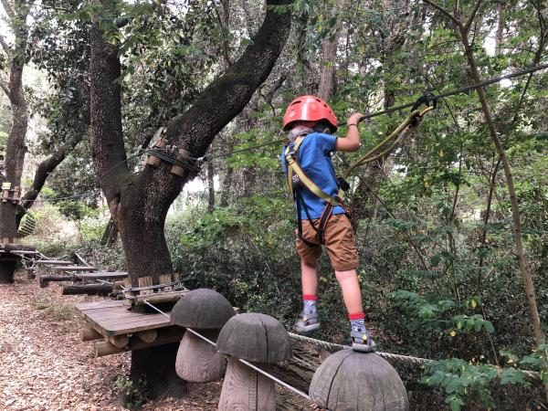

Cuando un docente ha liderado un proyecto sabe que la mirada del alumnado, las familias y cuantas personas se implican en él, cambia radicalmente. Las gafas por las que ven el mundo que les rodea gira en torno a la aventura que están viviendo.

Como todas las buenas historias, un día sucede algo que lo cambia todo. Algo que centra la atención de las personas, les invita a realizar preguntas sobre el tema y buscar respuestas que les permita actuar. Con ello, los docentes acompañan al grupo en una aventura que le lleva a aprender cosas nuevas, a desarrollar habilidades que ahora se demuestran necesarias y a tomar partido: a soñar un mundo nuevo y ejercer acciones decididas para cumplir esos sueños.

¿Qué hace que un proyecto se convierta en una aventura o quede simplemente como un conjunto de actividades interconectadas por eje temático?

Algunas personas dicen que la piedra angular de un ABP para que esto suceda es que exista un producto final bien definido. Para ellas, el esfuerzo de los docentes se orienta en dos tareas:

1.        Definir de manera pormenorizada el producto esperado.

2.        Diseñar una acción motivadora que incite al alumnado a realizarlo.

Esto deja fuera todos los proyectos que no nacen con dicho producto definido desde su inicio y también aquellos en los que el motor que dispara el proyecto no es algo divertido o placentero para el estudiante. Algo que limita de manera importante el ABP desde mi punto de vista.

A partir de ahí, el docente diseña con relativa facilidad los resultados esperados en la adquisición de saberes y habilidades. También, como medirlas de forma que se pueda realizar una evaluación relativamente sencilla.

La presencia de contenidos curriculares de distintas áreas de conocimiento puede preverse fácilmente ya que las características del producto final son expresadas de forma univoca por el docente al inicio del proyecto. El alumnado centra su atención -en colaboración con sus familias- en el proceso que lleva al producto esperado hábilmente guiados por su docente que les acompaña en el proceso con el fin de:

1.        Asegurar que la actividad del alumnado no se separa de la realización del proyecto esperado.

2.        Obligar al alumnado a que deba incorporar aquellos contenidos curriculares que previamente el docente ha establecido como propios del proyecto.

3.        Evaluar la adquisición de los mismos de forma individual y grupal midiendo tanto el producto como el proceso seguido para realizarlo.

Este modelo didáctico es común en decenas de escuelas del mundo y responde a un esfuerzo por estandarizar la implementación del ABP en la práctica. Para ello *tecnifica* una estrategia didáctica dejando fuera los elementos más valiosos del enfoque ABP: *cambiar las escuelas y las personas que las habitan convirtiéndolas en agentes activos de la comunidad*.

Una manera más interesante de valorar la potencia del ABP en las prácticas docentes es interrogarse sobre su capacidad para cambiar las escuelas y las personas que alberga. Para hacerlo, debemos centrar nuestra atención en las miradas de las personas y no tanto en su capacidad para resolver un conjunto de problemas técnicos orientados a la construcción de un producto final.

EL ABP debe permitir a sus participantes tomar partido por una realidad cercana, investigar en torno a ella, reflexionar sobre su impacto en sus propias vidas y decidir acciones concretas fruto de este proceso. Tras hacerlo, es imposible que la realidad de las escuelas sea igual que al inicio. Tampoco las personas que las habitan.

Hacerlo exige que el aprendiz viva en primera persona el proyecto como una verdadera aventura a la que se suma con capacidad de actuar sobre ella. Y es esta necesidad de vivir el ABP en primera persona una de las claves fundamentales para cambiar las escuelas fruto del aprendizaje.

El proyecto debe hablar de cada uno de los alumnos y alumnas que lo protagonizan. De sus vidas, de su realidad. Una realidad -no lo olvidemos- que en la actualidad está dominada por las redes relacionales, la comunicación, la tecnología y la variabilidad, tanto como de sus iguales, sus maestros y maestras, sus familias, sus barrios o comunidades de referencia. Una realidad sobre la que deben reflexionar y que se hace problemática en la medida que se acerca a cada uno de ellos y ellas. Posiblemente la necesidad de alimentación saludable conectará más con el alumnado cuando le invitamos a abrir la nevera de sus casas que al analizar estadísticas globales. De igual manera, la pobreza será objeto de interés para el alumnado cuando hablamos de los familiares en paro, las personas “*sin techo*” del barrio o las facturas de su propia familia, que si lo hacemos en términos generales en un principio. En todos los casos, los contenidos curriculares necesarios para comprender este fenómeno son similares. Con la única diferencia de que tras vivirlo en primera persona, el aprendiz tendrá más interés en un análisis posterior de carácter global.

Decir que el proyecto debe conectar con la primera persona del alumnado no quiere decir que el ABP deba hablar de ellos y ellas exclusivamente. Lo que quiero decir es que éste debe permitir, al que lo vive, reconocerse en la realidad que se plantea. Para ello es necesario entender que la segunda clave fundamental que podemos describir para que el ABP tenga capacidad de protagonizar la aventura del aprendizaje es la de tener una *estructura narrativa* adecuada.

No basta con que el eje temático del proyecto sea interesante. Es necesario que permita narrar una historia.

Kenneth Burke decía que “*las historias nos aprovisionan para la vida*” y es cierto. Como bien señalaba Roland Barthes “*el relato empieza con la historia misma de la humanidad; no hay, nunca ha habido un pueblo sin relato*”.

Cuando nos sumergimos en una buena historia, pensamos que esta hablará de las personas que la protagonizan. Sin embargo, debemos darnos cuenta de que

si las reconocemos como buenas narraciones, es porque hablan de nosotros mimos. Nos reconocemos en los personajes que, a través de la historia, viven enlaces y desenlaces muy cercanos: los afectos, la experiencia que da la edad, la heroicidad, la felicidad, la tristeza, la necesidad de actuar, las ideas, el amor, la muerte, etc.

Como señalaba Robert Mackee para el caso de las películas; “*vamos al cine para acceder a un mundo nuevo y fascinante, para suplantar virtualmente a otro ser humano (…) para vivir en una realidad distinta que ilumina nuestra realidad cotidiana*”.

Esto amplía mucho las posibilidades a la hora de diseñar proyectos ABP para nuestro alumnado pero nos obliga a atender a que la lógica estructural de la narrativa que lo describe sea correcta. Un relato debe estar bien construido; nuestro ABP también.

La buena noticia es que sabemos mucho de cómo puede ser la estructura de una narración. Algo a lo que debemos atender en el diseño mismo de nuestro ABP.

Un buen proyecto se inicia -al igual que toda aventura- con un *detonante*. Algo sucede que obliga a mirar a todo el grupo en torno a ello. En unas ocasiones, será un suceso especial que acontece en la comunidad, una visita inesperada, un viaje o una demanda de la comunidad o de la escuela misma. En otras serán los docentes los que diseñarán una acción que cambia la rutina escolar.

La condición fundamental será que el detonante que vive el alumnado conecte directamente con sus vidas. A partir de ahí comienza la aventura de aprender, la necesidad de preguntar y buscar respuestas, de organizarse, reflexionar y decidir acciones que respondan a la reflexión sobre lo aprendido y lo vivido.

Podemos describir algunas claves para la construcción de estos relatos ABP -a ello dedicaré algunos post a partir de ahora-, pero el primero debe ser preguntarnos como revertir el modelo de enseñanza que realizamos en nuestras clases en un modelo narrativo.
