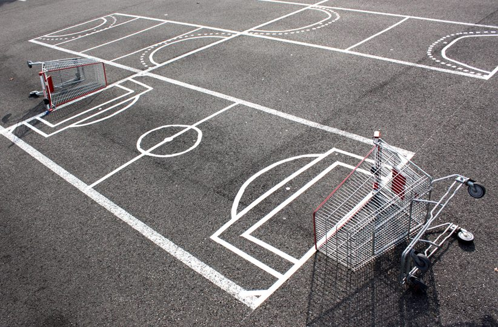

*No pay, play.* Estrasburgo (F. Rivière. 2011. Foto: J. Roth) <https://laciudadvisitada.blogspot.com/2020/11/a-jugar-la-calle.html>

[[Publicado en Cuadernos de Pedagogía. marzo 2025]](https://lc.cx/CO_qs9)

En 1992 [Marc Augé](https://es.wikipedia.org/wiki/No-lugar) escribió un pequeño libro titulado *Los no lugares, espacios del anonimato: una antropología de la sobremodernidad*.

En este controvertido libro inventaba el término *no-lugar* para obligarnos a reflexionar sobre aquellos espacios de anonimato que -en definitiva- pierden las personas frente a los consumos. Un ejemplo de lo que Augé llamaba *no-lugares* son los centros comerciales. Espacios que este antropólogo identificaba con la ausencia de relaciones e imposibilitaba la construcción de la identidad.

Luego se demostró que esto solo es cierto en parte. Veinte años después, se realizaron investigaciones sobre la juventud que habita estos centros comerciales con un dato revelador: los jóvenes utilizan estos espacios para generar relaciones sociales, conocer gente y divertirse. Frente a cualquier previsión por nuestra parte; las personas son capaces de humanizar cualquier espacio por hostil que parezca. ¡Aunque algunos son más sencillos de humanizar que otros! (y aunque *el medio* en que se producen es determinante. Eso decía hace bastantes décadas un tal McLuhan preocupado entonces de la *información* y no los *relatos*. Pero eso nos llevaría mucho más espacio del que tengo aquí). Volvamos:

En los años 70 del siglo pasado los niños utilizaban las calles de las ciudades para jugar, hacer amigos y divertirse. Era bastante común escuchar los gritos proferidos desde las ventanas de los edificios llamando a la merienda: “*Juanitooooo sube a merendar*”. Cuando Juanito escuchaba esta llamada, corría a su casa a recoger el bocadillo de salchichón que tanto le gustaba.

Para hacerlo entraba en el portal y subía las escaleras. Puede que de camino se cruzara con alguien del vecindario a quien conocía y saludaba con cortesía: “*Buenas tardes don Andrés*”. Efectivamente: El portal estaba abierto y, en la gran mayoría de las casas de la ciudad, la forma de subir a la vivienda era la escalera.

Algunos años después comenzaron a instalarse los “*porteros automáticos*” (en otro momento os contaré del trabajo de mi abuelo que era portero en una comunidad de vecinos de mediados del siglo pasado). En España el *portero automático* puede decirse que comenzó a instalarse sobre los años 60 del siglo pasado. No así el ascensor, un artilugio bastante más antiguo que estaba solo generalizado entre los barrios de clases más altas y que hoy en día se extiende a la práctica totalidad en lo que es un necesario avance para garantizar la movilidad. (Es curioso que los dispositivos de seguridad se implantaran con mayor celeridad que los que garantizan el acceso a la vivienda propia). Volvamos de nuevo:

En muchas ocasiones he preguntado a mi alumnado si conocían el nombre de sus vecinos. La respuesta mayoritaria era que no. Estamos hablando de alumnado mayor de edad y en enseñanza superior.

Entrado ya el siglo en el que vivimos se generalizó el uso de teléfonos móviles. El grito de “*Juanitoooo a merendar*” se ha sustituido por la *Notificación*. El niño o la niña recibe un *mensaje de audio* en el que se le requiere para merendar. Posiblemente ya no se encuentre en la calle jugando con sus amistades y lo reciba en su habitación.

La buena noticia es que en muchas ocasiones estará jugando con otros niños y niñas en su cuarto. Una actividad formativa y saludable, aunque ya no pueda hacerse en “*la calle*”. Si esto no sucede, es muy posible que esté utilizando las *redes* para relacionarse con otras personas de su edad. (En este punto no puedo dejar de recordar aquella viñeta de[*El Roto*](https://auladefilosofia.net/wp-content/uploads/2009/05/20090521elpepivin_5_ges_sco.gif)en el que se puede ver un niño sentado en el suelo con su ordenador y dice “*Sospecho que me han dado este ordenador para que no mire por la ventana*”). En cualquier caso:

Hay que felicitarse de la obsesiva insistencia de las personas por humanizar cuantos *espacios físicos y virtuales* habitan. Sobre todo, en tiempos en que la *Inteligencia Artificial* es el nuevo desafío educativo.

Es cierto que cada vez lo ponen más difícil. Pero la creatividad del ser humano parece obstinarse a perder el control de la vida. Esperemos que siga así mucho tiempo. Quizá el gran reto de la educación en la actualidad sea apoyar este objetivo dotando de herramientas a las personas para no dejarse dirigir por los cacharros, los espacios, la falta de ellos y las narraciones que no ponen a las personas en el centro.
