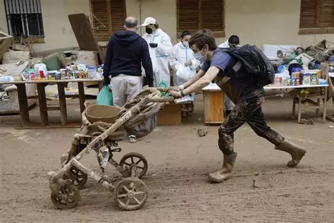

Hace meses me invitaban a participar en el número monográfico de Cuadernos de Pedagogía coincidiendo con el año desde que algunas vecinas de Valencia sufrieron la Dana. Un desastre que me recordaba un viaje anterior que tuve ocasión de realizar a un barrio de Alfafar (el Parque Alcosa) y que las riadas inundaron de agua, barro, tristeza y rabia.

Citaré aquí un pequeño párrafo que resume mi reflexión sobre todo ello:

"*En el caso de "La Dana" se ha utilizado el talismán de la recuperación. El deseo más escuchado en los medios de comunicación es "la vuelta a la normalidad". Sin embargo, en el caso del Parque Alcosa -como en tantos otros- no es la vuelta a la normalidad lo que se necesita. Lo realmente necesario es que este suceso se vea como un punto de inflexión necesario en la redefinición de realidades sociales que necesitan intervención de todo tipo. Para ello, sería buena idea preguntar al propio barrio cuáles son sus necesidades y no implementar reconstrucciones que reproduzcan nuevamente la desigualdad y la marginación"*

El texto completo en....<https://acortar.link/yVgatJ>
